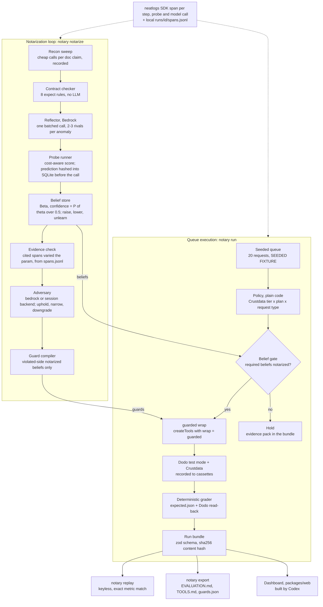

# Notary

**An agent that won't touch money until it has proven how its tools actually behave.**

Notary is a billing-ops agent for the neatHack hackathon. It works a queue of refunds, partial refunds, plan changes and credits, using [Crustdata](https://crustdata.com) for company context and [Dodo Payments](https://dodopayments.com) in **test mode** to execute. Before any irreversible action it checks, by pre-registered experiment, the specific tool behaviors that action depends on. If a behavior isn't proven, the request is held for a human with the evidence attached.

> **Status, plainly.** No API keys were available while this was built, so **no live run has been recorded yet**: no cassettes, no notarized beliefs, no headline numbers. Every pipeline below is implemented and unit-tested against doubles and test-only cassettes, and each one stops with `BLOCKED: <VAR> not set` (exit 3) instead of faking a result. The only numbers in this README come from checks that need no keys, copied from [`docs/EVALUATION.md`](docs/EVALUATION.md).

## The problem

Agents trust tool documentation by default, and when the tool moves money that trust is the most expensive bug in the system. A docs page can say a refund amount is in units when it's in cents, that a timed-out request wasn't processed when it was, or that a list returns everything when it stops at a page cap. None of these crash anything: every call returns 200, every trace looks green, and the damage turns up later as a double refund in the payments dashboard.

## How it works

Two loops share one belief store. Deterministic code makes every decision. Models only propose hypotheses and review beliefs.

**Notarization loop** (`pnpm notary notarize --tool <crustdata|dodo>`):

1. **Recon + contract checker.** Doc claims, hand-written from the real docs ([`src/contracts/`](packages/core/src/contracts/)), are checked against recorded responses. No LLM is involved, and the same exchanges always give the same anomalies.
2. **Reflector.** One batched Bedrock call proposes 2–3 rival hypotheses per anomaly, each tagged with a defect class.
3. **Probe selection.** Eight probe templates, ranked by a greedy cost-aware score: rivals separated ÷ (credits + λ·calls).
4. **Commit, then run.** Each prediction is hashed and written to SQLite before the HTTP call goes out. A trigger blocks any later change.
5. **Verdict + belief.** Fixed verdict rules feed a Beta(α, β) belief. Only `confirmed` verdicts move it. Uninformative, inconclusive and invalid probes are logged but change nothing. A belief can rise, fall and be **unlearned**.
6. **Evidence check.** Every cited probe span must actually have varied the claim's parameter (FR-10).
7. **Adversary.** A different, stronger model, or a headless Claude Code session, tries to refute each candidate belief using only the raw probe records. It can uphold, narrow or downgrade.
8. **Guard compiler.** Notarized beliefs on the *violated* side compile into guards.

**Gated queue** (`pnpm notary run --queue …`):

1. Crustdata enrichment sets each customer's tier, and a plain-code policy table picks the outcome.
2. **Belief gate:** every belief that the action requires must be notarized. If any is missing, the item is **held** with an evidence pack.
3. Every Dodo/Crustdata method runs through `guarded()`: transform, require_param, precheck, retry_policy, paginate_fully or block. There are no blind write retries. An unknown outcome is read back first.
4. A deterministic grader compares decisions with hand-written expected outcomes and with Dodo state read back before and after the run.



The full design, as built, is in [`docs/ARCHITECTURE.md`](docs/ARCHITECTURE.md).

## Results

Every row links to [`docs/EVALUATION.md`](docs/EVALUATION.md), which `pnpm notary export` generates from hash-verified run bundles. Nothing in that file is typed by hand. **Today it is generated from 0 real bundles**, so every PRD headline metric is *not measured yet*.

### PRD success metrics

| Metric | PRD target | Value today | Command that will produce it |
| --- | --- | --- | --- |
| [Unsafe money actions](docs/EVALUATION.md#success-metrics-prd) | Run 1 > 0; run 2 = 0 | **not measured yet (needs API keys)** | `pnpm notary run --queue packages/core/fixtures/queue/seeded.json --naive`, then the same without `--naive` |
| [Belief precision](docs/EVALUATION.md#success-metrics-prd) | ≥ 0.8, false beliefs = 0 | **not measured yet (needs API keys)** | `pnpm notary notarize --tool crustdata` (and `--tool dodo`) |
| [Unguarded call sites](docs/EVALUATION.md#success-metrics-prd) | 0 | **no run bundle yet**; measured keylessly below | `pnpm notary guards coverage` |
| [Cost per queue run](docs/EVALUATION.md#success-metrics-prd) | Run 2 lower than run 1 | **not measured yet (needs API keys)** | `pnpm notary run --queue packages/core/fixtures/queue/seeded.json [--naive]` |
| [Probes to confirm on Dodo, with vs without priors](docs/EVALUATION.md#success-metrics-prd) | Fewer with priors | **not measured yet (needs API keys)** | `pnpm notary notarize --tool dodo --compare-priors --priors-from crustdata` |
| [Automation rate](docs/EVALUATION.md#success-metrics-prd) | Reported honestly | **not measured yet (needs API keys)** | `pnpm notary run --queue packages/core/fixtures/queue/seeded.json` |
| [Reproducibility](docs/EVALUATION.md#success-metrics-prd) | Exact match | **not measured yet (nothing recorded to replay)** | `pnpm notary replay` |
| [Noise floor](docs/EVALUATION.md#not-yet-measured-blocked) | Measured before claiming change | **not measured yet (needs API keys)** | `pnpm notary eval noise-floor --queue packages/core/fixtures/queue/seeded.json` |
| [Drift un-learning (FR-16)](docs/EVALUATION.md#not-yet-measured-blocked) | Belief un-learns, guard retires | **not measured yet (no real cassette to alter)** | `pnpm --filter @notary/core make:drift …`, then `pnpm notary replay --drift <name>` |

### Checks that don't need API keys

These values are copied from [`docs/EVALUATION.md` → Checks that don't need API keys](docs/EVALUATION.md#checks-that-dont-need-api-keys). Export ran each command at the time stamped in that file. Re-run the command to reproduce it. If code has changed since the last export, the count can differ.

| Command | Result (from EVALUATION.md) |
| --- | --- |
| [`pnpm test`](docs/EVALUATION.md#checks-that-dont-need-api-keys) | PASS: 481 passed, 0 failed (481 tests in 28 files) |
| [`pnpm notary guards coverage --json`](docs/EVALUATION.md#checks-that-dont-need-api-keys) | PASS: unguarded_call_sites = 0 (27 sites: 21 guarded, 6 raw-by-design; backend tsc) |

The coverage check uses the TypeScript-checker backend. The PRD asks for `entire graph` callers. That backend is implemented, but it is unverified because the Entire CLI isn't installed (see [limits](#honest-limits)).

## 5-minute offline quickstart

Needs Node ≥ 22 (built on Node 24) and pnpm. No `.env` and no keys.

```sh
pnpm i && pnpm notary replay
```

**What `replay` does today:** it finds the one bundle in the repo, the synthetic SAMPLE bundle [`packages/web/public/bundles/sample-42.json`](packages/web/public/bundles/sample-42.json), recomputes its sha256 content hash (`verified 1 bundle(s)`), and then stops with `BLOCKED: no recorded live runs to replay … record runs with API keys first`, exit code 3. That is the correct answer: replay never reports a pass when there's nothing recorded. Once live runs are recorded, it re-runs each one from its cassettes with no environment at all and compares every metric, and every probe, belief and decision record, exactly. Any cassette miss, tampered file or mismatch exits 1.

Other things that run offline today:

```sh
pnpm test                       # vitest across the workspace
pnpm notary guards coverage     # every raw client method reachable only through guarded(); exit 0 = 0 unguarded
pnpm notary export --sample     # (re)write the synthetic SAMPLE bundle for dashboard development
pnpm notary export              # regenerate docs/EVALUATION.md, export/TOOLS.md, export/guards.json (runs pnpm test + coverage)
pnpm --filter @notary/core seed:dodo --plan   # print the Dodo test world the seed would create; no network
node scripts/fresh-clone-check.mjs            # clone HEAD to a temp dir, install, run replay with credentials stripped
```

Node 24 prints `ExperimentalWarning: SQLite is an experimental feature` the first time the store opens. It is harmless ([DECISIONS #34](docs/DECISIONS.md)).

## Recording real runs

Copy [`.env.example`](.env.example) to `.env` (gitignored) and fill in the variables each step needs. Steps are listed in order. Every command exits 3 with `BLOCKED: <reason>` when something it needs is missing, before it makes any network call.

| # | Command | Needs (from `.env.example`) | Produces |
| --- | --- | --- | --- |
| 1 | `pnpm --filter @notary/core seed:dodo` | `DODO_PAYMENTS_API_KEY` (test mode), `NOTARY_MODE=test`, `DODO_BASE_URL=https://test.dodopayments.com`. **Plus a human:** the script prints **12 hosted test-card checkout URLs**, one per seeded customer (incl. the probe-only customer, [DECISIONS #82](docs/DECISIONS.md)), and polls until each one is completed in a browser ([DECISIONS #28](docs/DECISIONS.md)). Dodo test mode documents no API-only way to complete a first payment. `--wait-minutes <n>` (default 30). | The Dodo test world (7 products, 12 customers, 167 payments, 31 refunds per `--plan`), `packages/core/fixtures/seed/manifest.json`, cassette `seed-dodo`. If headless `confirm:true` checkouts don't charge, it stops and writes no manifest. |
| 2 | `pnpm notary notarize --tool crustdata` | `CRUSTDATA_API_KEY`, `CRUSTDATA_CREDIT_BUDGET` (default 200), `NOTARY_MODEL_REFLECTOR`, `NOTARY_MODEL_ADVERSARY` (must differ from the reflector), `AWS_REGION` + AWS credentials (default chain). Optional: `NEATLOGS_API_KEY`, `NOTARY_MAX_PROBES_PER_CLAIM`. `--adversary session` needs the `claude` CLI on PATH. | Notarize bundle in `packages/core/runs/<runId>/`, cassettes `<runId>-recon/-probes/-llm/-inputs` in `packages/core/fixtures/cassettes/`, beliefs + guards in `packages/core/runs/notary.sqlite` |
| 3 | `pnpm notary notarize --tool dodo --priors-from crustdata` | `DODO_PAYMENTS_API_KEY` (test), the same model + AWS variables, and the seed manifest from step 1 (refund probes use only seeded payments the queue never touches, [DECISIONS #42](docs/DECISIONS.md)) | Dodo beliefs that start from Crustdata-learned priors |
| 3b | `pnpm notary notarize --tool dodo --compare-priors --priors-from crustdata` | No keys: it replays the `probes-dodo` cassette twice | `probes_to_candidate_with_priors` / `_without_priors` |
| 4 | `pnpm notary run --queue packages/core/fixtures/queue/seeded.json --naive` | `CRUSTDATA_API_KEY`, `DODO_PAYMENTS_API_KEY` (test), seed manifest | Run-1 baseline bundle (no gate, no guards) |
| 5 | `pnpm notary run --queue packages/core/fixtures/queue/seeded.json` | Same as step 4, plus the notarized beliefs from steps 2–3 in the local store | Guarded run bundle. After a crash, continue it with `pnpm notary run --resume [--run <runId>]` |
| 6 | `pnpm notary eval noise-floor --queue packages/core/fixtures/queue/seeded.json [--runs 3]` | Same as step 5 | `noiseFloor` written into each run bundle and `runs/noise-floor.json` |
| 7 | `pnpm notary replay` | Nothing: no `.env` is loaded | Replay bundles with `replayOf`, plus an exact metric comparison |
| 8 | `pnpm --filter @notary/core make:drift --from <cassette> --exchange <requestHash>[:occurrence] --set '<jsonPath>=<json value>' --out <name>`, then `pnpm notary replay --drift <name>` | Nothing (a real recorded probes cassette) | A labelled drift fixture in `packages/core/fixtures/drift/`, a belief trajectory and the guards it retires |
| 9 | `pnpm notary export` | Nothing | `docs/EVALUATION.md`, `export/TOOLS.md`, `export/guards.json`, and the newest real bundle per category copied to `packages/web/public/bundles/` |

Read these caveats before running the sequence:

- **The seeded world is single-use.** Each live run moves real test-mode state. The naive run's refunds are still in Dodo when the guarded run starts, and `eval noise-floor` doesn't re-seed between its runs (comment in [`src/eval/noise-floor.ts`](packages/core/src/eval/noise-floor.ts)). Re-seeding means `seed:dodo --force` and another 11 human checkouts. The code doesn't automate this, and no re-seed step has been tried.
- **Run step 9 before committing.** `packages/core/runs/` is gitignored, so a fresh clone can only replay bundles that `export` copied to `packages/web/public/bundles/`, and it copies only the newest bundle per category.
- Optional tuning variables that the code reads but `.env.example` doesn't list: `NOTARY_PROBE_LAMBDA`, `NOTARY_PRIOR_STRENGTH`, `NOTARY_DRIFT_MAX_PASSES`, `NOTARY_PRICE_<ROLE>_IN` / `_OUT` (needed for USD on model ids missing from the built-in price table, [DECISIONS #36](docs/DECISIONS.md)).
- `pnpm notary doctor` sends one neatlogs smoke span. Run it first to confirm `NEATLOGS_API_KEY` works.

## How each sponsor is used

| Sponsor | What the code does | Verified? |
| --- | --- | --- |
| **neatlogs** (required) | The `neatlogs` TS SDK (1.1.26) wraps every queue item, recon step, probe and model call in a span through `withSpan` ([`src/trace/`](packages/core/src/trace/index.ts)). Probe spans carry `notary.prediction` (committed before the call), plus `notary.runId`, `notary.claimId`, `notary.probeId` and `notary.verdict`. Every span is also written to `runs/<runId>/spans.jsonl`, which is what the FR-10 evidence check and held-item evidence packs read. `notary doctor` sends a smoke span. | **No span has reached neatlogs**: `NEATLOGS_API_KEY` was never set. `neatlogs-cli` is not installed, so evidence is read from `spans.jsonl` ([DECISIONS #48](docs/DECISIONS.md)). Bundle `traceLinks` point to local `spans.jsonl` receipts, not neatlogs URLs. |
| **Entire** (required) | `notary guards coverage --backend entire` shells out to `entire graph neighbors --symbol … --direction in --format json` ([DECISIONS #61](docs/DECISIONS.md)). The adversary's `session` backend runs headless Claude Code and commits each verdict file (`adversary: <verdict> <beliefId>`), so Entire would checkpoint each review next to its belief ([DECISIONS #50](docs/DECISIONS.md)). | **Unverified.** The Entire CLI isn't installed on the build machine: no `entire enable`, no checkpoints, and coverage falls back to the `tsc` backend. The `session` backend has not run live. |
| **cfo.ai** (required) | Business plan (pricing per monitored contract, COGS from bundle credits and tokens, incidents prevented, runway). | **Not started.** Planned for P10 as a manual step that produces `docs/BUSINESS.md` and `packages/web/public/economics.json`. Neither exists yet. |
| **Crustdata** | Company enrichment for policy tiers (`POST /company/enrich`, `/company/identify`, `GET /account/credits`). It is the first tool notarized: 11 claims. A per-run credit ledger reserves the estimated cost before each call, settles from `X-Credits-Used`, and stops the run cleanly at `CRUSTDATA_CREDIT_BUDGET`. See [`docs/ENDPOINTS.md`](docs/ENDPOINTS.md). | No live call yet (no key). |
| **Dodo Payments** (test mode) | Refunds, plan changes and wallet credits. It is the second tool notarized (15 claims, with transfer priors from Crustdata). It seeds the test world. The client refuses to start unless `NOTARY_MODE=test` and the base URL is exactly `https://test.dodopayments.com`. | No live call yet (no key). Seeding also needs 11 human checkouts. |
| **AWS Bedrock** | `@aws-sdk/client-bedrock-runtime` Converse API at temperature 0. Three roles come from env. The reflector proposes hypotheses. The adversary reviews beliefs and must be a different model ([DECISIONS #37](docs/DECISIONS.md)). Tokens and USD are tracked per role in `bundle.usageByRole`. | No live call yet (no model ids or AWS credentials). The `executor` role is configured but no code path calls it today, because queue decisions are plain policy code ([DECISIONS #33](docs/DECISIONS.md)). |

## CLI reference

Run commands with `pnpm notary <command>` from the repo root, and see `pnpm notary <command> --help` for details. Commands load `.env`, except `replay` and `eval noise-floor --replay`, which never read it.

| Command | Flags | Does |
| --- | --- | --- |
| `notarize` | `--tool <crustdata\|dodo>` (required) · `--priors-from <crustdata\|dodo>` · `--priors-bundle <path>` · `--recon-only` · `--replay` · `--adversary <bedrock\|session>` (default `bedrock`) · `--compare-priors` | Recon → checker → reflector → probes → beliefs → evidence check → adversary → notarize bundle. `--recon-only` stops after the checker. `--replay` serves the `recon-<tool>`/`probes-<tool>` cassettes. `--compare-priors` replays the probe loop twice (without and with priors). |
| `run` | `--queue <file>` (required unless `--resume`) · `--naive` · `--resume` · `--run <runId>` (with `--resume`) · `--replay <cassette>` | Works the queue and writes a run bundle. Guarded by default. `--naive` is the ungated run-1 baseline. |
| `replay` | `--bundle <id>` · `--drift <fixture>` | Keyless re-run of every recorded live bundle (or one), with exact metric comparison. Exit 0 match, 1 miss/tamper/mismatch, 3 nothing recorded. `--drift` replays a drift fixture. |
| `eval noise-floor` | `--queue <file>` (required) · `--runs <n>` (default 3) · `--replay` | Runs the guarded queue N times and records max − min per metric as its noise floor |
| `export` | `--sample` · `--seed <n>` (default 42, with `--sample`) · `--out <dir>` · `--runs-dir <dir>` · `--root <dir>` · `--no-checks` | Writes `export/TOOLS.md`, `export/guards.json` and `docs/EVALUATION.md` from real bundles only, and copies the newest bundles to the dashboard. `--sample` writes the synthetic SAMPLE bundle instead. |
| `guards coverage` | `--json` · `--backend <auto\|entire\|tsc>` (default `auto`) | Caller check over every raw client method. Exits non-zero on any unguarded call site. |
| `serve` | `--port <port>` (default 8787) · `--host <host>` (default `127.0.0.1`) | Read-only local API: `GET /api/bundles`, `GET /api/bundles/:id`, SSE `GET /api/stream` |
| `doctor` | none | Emits one neatlogs test span and flushes. Exit 1 if no span was sent. |

| Script | Does |
| --- | --- |
| `pnpm test` / `pnpm typecheck` | vitest / tsc across the workspace |
| `pnpm check:secrets` | Key-pattern and `.env`-value scan of tracked files and fixtures (the pre-commit hook in `.githooks/`) |
| `pnpm --filter @notary/core seed:dodo [--plan] [--force] [--wait-minutes <n>]` | Seed the Dodo test world (`--plan`: print only, no network) |
| `pnpm --filter @notary/core make:drift --from … --exchange … --set … --out … [--force]` | Make a drift fixture from a real cassette |
| `node scripts/fresh-clone-check.mjs [--include-uncommitted] [--test] [--keep]` | Fresh-clone install + keyless replay with credentials stripped from the environment |

## Honest limits

- **No API keys, so no results.** Crustdata, Dodo, Bedrock and neatlogs keys were all missing. Every live step in [`PLAN.md`](PLAN.md) is marked `BLOCKED`. No belief has been notarized and no adversary verdict exists. [`export/TOOLS.md`](export/TOOLS.md) lists every claim as unverified.
- **Seeding needs a human.** There are 11 hosted test-card checkouts, and it's undocumented whether the other ~108 headless `confirm:true` payments charge without customer action ([DECISIONS #28](docs/DECISIONS.md)). The seeded world is also single-use across runs (see caveats above).
- **Two required beliefs have no doc claim.** The docs make no promise about partial-refund rounding or about plan-change timing (immediate vs next billing date). Rounding uses `dodo.refunds.amount-integer` as a proxy and floors client-side. For timing, the guarded run sends `effective_at: "immediately"` explicitly. Both gaps are written into each run bundle's disclosure ([DECISIONS #22, #54](docs/DECISIONS.md)).
- **Crustdata type claims may abstain.** `type_edge` has only two variants, so these claims can end between thresholds ([DECISIONS #47](docs/DECISIONS.md)).
- **Some designed failures may not trip.** The "existing refund on a later page" case probably won't trip the naive agent ([DECISIONS #32](docs/DECISIONS.md)). Whatever happens will be reported as is.
- **Entire is unverified.** The `entire` coverage backend and the `session` adversary have never run against the real tools ([DECISIONS #50, #61](docs/DECISIONS.md)).
- **neatlogs is unverified.** No span has been exported, and `neatlogs-cli` isn't used ([DECISIONS #48](docs/DECISIONS.md)).
- **`node:sqlite` is experimental** on Node 24 and prints a warning ([DECISIONS #34](docs/DECISIONS.md)).
- **The dashboard isn't here yet.** It is Codex's `packages/web` (phases U1–U3). Today that package holds only the SAMPLE bundle and a placeholder README.
- **USD for unknown model ids is $0 plus a recorded warning**, not a guess, until `NOTARY_PRICE_<ROLE>_*` is set ([DECISIONS #36](docs/DECISIONS.md)).

## Disclosure: seeded and synthetic data

- **Seeded queue (SEEDED FIXTURE).** [`packages/core/fixtures/queue/seeded.json`](packages/core/fixtures/queue/seeded.json) holds 20 hand-written requests against Dodo test-mode customers created by [`packages/core/scripts/seed-dodo.ts`](packages/core/scripts/seed-dodo.ts). Company domains are real so Crustdata can enrich them. Expected outcomes in [`expected.json`](packages/core/fixtures/queue/expected.json) were written by hand from the policy table before any run. See [`fixtures/queue/README.md`](packages/core/fixtures/queue/README.md) for the designed cases. No real person or real money is involved.
- **Sample bundle (SYNTHETIC).** [`packages/web/public/bundles/sample-42.json`](packages/web/public/bundles/sample-42.json) is generated by [`src/bundle/sample.ts`](packages/core/src/bundle/sample.ts) for dashboard development: fictional companies on example.com, `[sample]` doc text, seeded-PRNG numbers. It is flagged `sample: true`, and `export` never uses it as a source of results.
- **Drift fixtures (DELIBERATELY ALTERED).** Each one is a copy of a real cassette with exactly one response field changed, carrying a `drift` disclosure block. None exist yet, because no real cassette exists ([`fixtures/drift/README.md`](packages/core/fixtures/drift/README.md)).
- Every bundle carries a `disclosure` array that the dashboard must show.

## Safety

- **Test mode only.** The Dodo client refuses to start unless `NOTARY_MODE=test` and the base URL is `https://test.dodopayments.com`. The docs define no live-key prefix, so the lock relies on those two values ([DECISIONS #15](docs/DECISIONS.md)).
- **Secrets.** Keys live only in `.env` (gitignored). Cassettes are redacted before writing (auth headers, secret-named fields, and any `.env` value whose name looks secret), and callers receive the redacted body even in live mode. Models never see keys. The adversary packet is scrubbed, and the `session` adversary is denied `.env` reads. `pnpm check:secrets` runs as a pre-commit hook. In a fresh clone, enable it with `git config core.hooksPath .githooks`.
- **Budgets and caps.** There is a hard per-run Crustdata credit budget: a reservation that would cross it never sends, and the run stops cleanly with `stopped_budget`. Probe caps: at most `NOTARY_MAX_PROBES_PER_CLAIM` probes per claim (default 5), `header_burst` at most 10 requests per run on free read ops with polite delays, and recon repeat and delay caps. Seeding stays under Dodo's documented sustained rate limit.
- **No blind write retries.** Pending writes are persisted before they are sent. On timeout, 5xx or `--resume`, Dodo state is read back with full pagination. A write is retried only when the read-back proves it didn't land. An undecidable outcome is held.
- **Model output is data.** Reflector and adversary replies are validated with zod. A malformed reply fails safe (no belief change), and no model output ever reaches the grader.

## Repo map

- [`packages/core`](packages/core/): the agent, CLI, schema, fixtures, tests (Claude Code)
- [`packages/web`](packages/web/): the dashboard (Codex). It reads bundles through the shared zod schema.
- [`docs/`](docs/): [PRD](docs/PRD.md), [TDD](docs/TDD.md), [ARCHITECTURE](docs/ARCHITECTURE.md), [DECISIONS](docs/DECISIONS.md), [ENDPOINTS](docs/ENDPOINTS.md), [EVALUATION](docs/EVALUATION.md) (generated), [BUILD_PLAN](docs/BUILD_PLAN.md)
- [`export/`](export/): [TOOLS.md](export/TOOLS.md) (corrected tool spec) and [guards.json](export/guards.json), both generated
