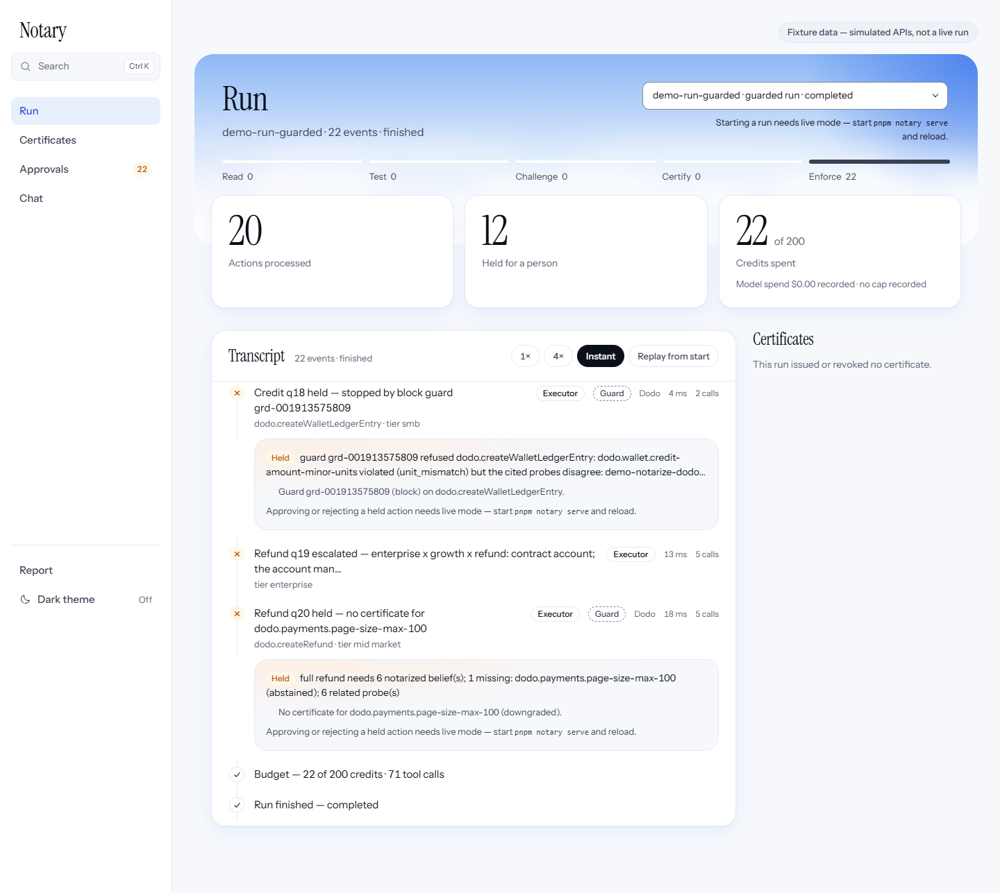
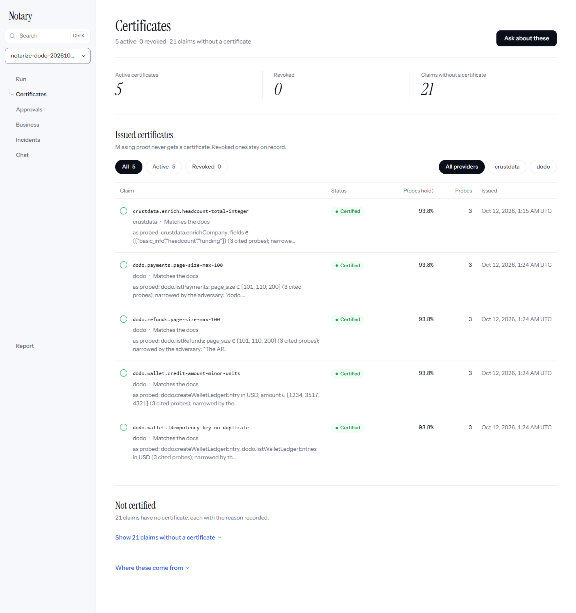
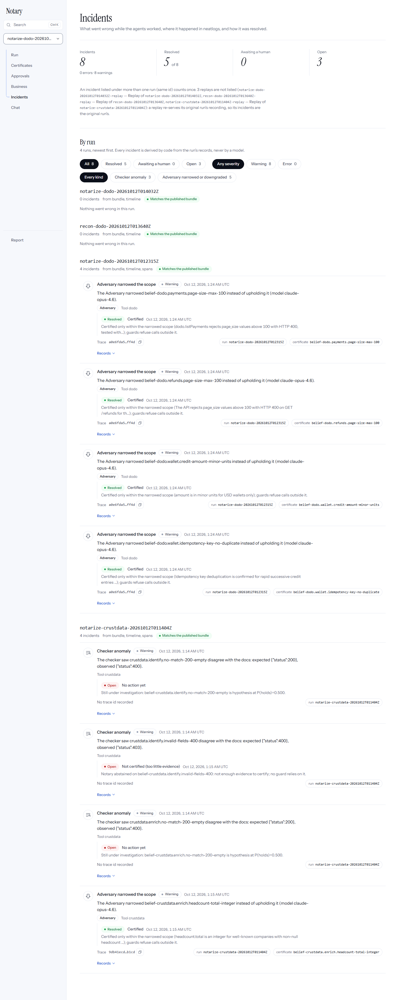
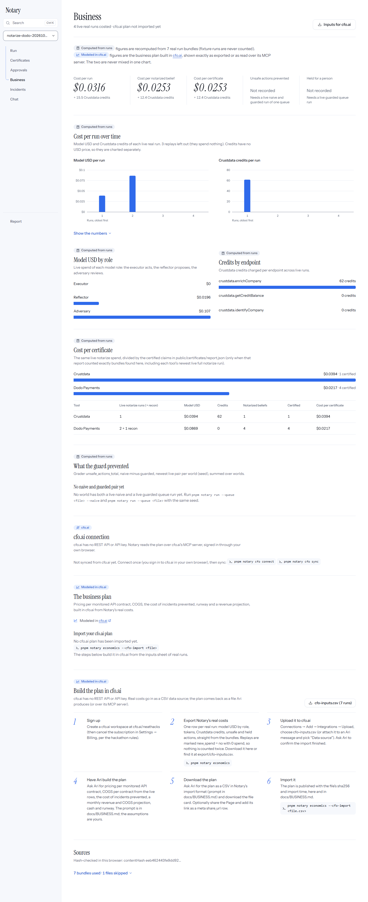
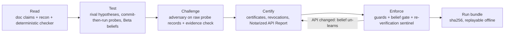

# Notary

**Notary certifies how your payment APIs actually behave, and won't move money on anything it hasn't certified.**

*Read → Test → Challenge → Certify → Enforce.* An agent that won't touch money until it has proven how its tools actually behave.

- **Dashboard:** `<deploy URL — pending>` <!-- TODO(orchestrator): paste the Vercel URL once deployed; until then run it locally (see Install) -->
- **Demo video:** `<video link — pending>` <!-- TODO(orchestrator): paste the video URL -->
- **Demo script:** [`docs/DEMO_SCRIPT.md`](docs/DEMO_SCRIPT.md) · **Full guide:** the `/docs` page of the web app


| Run transcript | Certificates | Incidents | Business |
| --- | --- | --- | --- |
|  |  |  |  |

Notary is a billing-ops agent for the neatHack hackathon. It works a queue of refunds, partial refunds, plan changes and credits, using [Crustdata](https://crustdata.com) for company context and [Dodo Payments](https://dodopayments.com) in **test mode** to execute. Before any irreversible action it checks, by pre-registered experiment, the specific tool behaviors that action depends on. If a behavior isn't proven, the request is held for a human with the evidence attached.

## What's real today (Oct 12, 2026)

Every number below links to the generated file that holds it. Nothing is typed by hand.

- **4 live runs on the real APIs, 3 offline replays.** `notarize --tool crustdata`, `notarize --tool dodo --priors-from crustdata` (twice) and a Dodo recon sweep ran against live Crustdata and Dodo test mode on Oct 12. All 7 bundles are hash-verified and published in [`packages/web/public/bundles/`](packages/web/public/bundles/) ([source table](docs/EVALUATION.md#source-bundles)).
- **Live Crustdata contradicts its own docs in 3 places.** The deterministic checker (no model) flagged: `/company/enrich` with a no-match domain returns **400** where the docs promise 200 with an empty result; `/company/identify` no-match returns **400**, not 200; `/company/identify` with invalid fields returns **403**, not 400 ([`anomalies` in the bundle](packages/web/public/bundles/notarize-crustdata-20261012T011404Z.json), [incidents](packages/web/public/incidents/notarize-crustdata-20261012T011404Z.json), [`anomalies` = 3 in EVALUATION](docs/EVALUATION.md#notarize-crustdata-20261012t011404z--notarize--notarize--crustdata-live-completed)). These are checker findings, **not certificates**: two were never probed and the one probe on identify invalid-fields was inconclusive, so the [certificate file](packages/web/public/certificates/crustdata.json) lists all three as unproven.
- **Prediction before every call.** Each of the 19 live probes (4 Crustdata, 15 Dodo) committed a sha256-hashed prediction before the HTTP call; `committedAt` precedes `ranAt` on every probe record in the bundles above.
- **5 real certificates, all "matches docs", 21 claims unproven** out of 26 ([`certificates/report.json`](packages/web/public/certificates/report.json), [`export/REPORT.md`](export/REPORT.md)). 1 on Crustdata (headcount is an integer), 4 on Dodo (page size max 100 on payments and on refunds, wallet credit amounts in minor units, wallet idempotency key).
- **The adversary narrowed all 5.** `claude-opus-4.6` reviewed the raw probe records and narrowed every belief's scope instead of upholding it (for example: wallet credits were tested only in USD, so the certificate covers USD only) ([`adversary.narrow` 1 + 4 in EVALUATION](docs/EVALUATION.md#every-metric-in-the-bundles), [incidents index](packages/web/public/incidents/index.json)).
- **Replays match exactly, offline.** The 3 replay bundles reproduce their live runs' metrics exactly with no keys ([Reproducibility row](docs/EVALUATION.md#success-metrics-prd)). One live run, `notarize-dodo-20261012T012315Z`, can't replay: a wallet credit reached the API but its body read failed, so its cassette lacks that exchange ([DECISIONS #200](docs/DECISIONS.md)); `notary replay` discloses it as skipped.
- **Cost:** the Crustdata notarize run cost **$0.0394 in model calls + 62 Crustdata credits** ([`usd_total`, `credits_total`](docs/EVALUATION.md#notarize-crustdata-20261012t011404z--notarize--notarize--crustdata-live-completed)); averaged over the 4 live runs, **$0.0316 + 15.5 credits per run** ([`economics.json` → `costPerRun`](packages/web/public/economics.json)).
- **0 unguarded call sites** on both coverage backends: 33 sites, 26 guarded, 7 raw-by-design, via `entire graph` ([keyless checks](docs/EVALUATION.md#checks-that-dont-need-api-keys), [`evidence/entire.json`](packages/web/public/evidence/entire.json)) and the TypeScript checker.
- **Traced in neatlogs:** AGENT, LLM, TOOL, GUARDRAIL and EVALUATOR spans; real traces `9db41ecd43406cef291c93ef8c9ab1cd` (Crustdata run) and `a0e6fda50d71a9eb2fec0f04843bff4d` (Dodo run) are the `traceId` on the probe records and incidents.

**Not real yet, said plainly.** The queue runs (naive vs guarded, the "unsafe actions → 0" comparison) are **BLOCKED** on seeding the Dodo test world, which needs 12 hosted test-card checkouts by a person. Until then that comparison exists only on Notary's [evaluation suite](docs/EVALUATION.md#evaluation-suite), which runs the real pipeline against **simulated APIs** with planted quirks (dashboard: add `?fixtures=1`; every screen shows a "Fixture data — simulated APIs, not a live run" banner). Real Dodo honored all 4 behaviors it certified, so a real naive run may well make 0 unsafe moves; what a real guarded run will show is that refunds needing a behavior with no certificate are held. No cfo.ai plan has been imported yet, the dashboard is not deployed, and the AWS deploy has not run (details in [How each sponsor is used](#how-each-sponsor-is-used) and [Honest limits](#honest-limits)).

<!-- REVIEW: start-time disclosure, user to confirm before making the repo public -->
**Timeline.** The Luma page and the organizers' Oct 9 email give the start as 12:00 AM IST, Oct 10, 2026; the hackathon website says 12:30 PM IST. The first commit is Oct 10, 02:49:08 IST. Planning docs (specs only, no code) were written on Oct 9. Sources and times: [hackathon.md → Start time and authenticity](hackathon.md#start-time-and-authenticity-audit-a-11-decisions-72).

## Install the CLI

Needs **Node 22 or newer** (built on Node 24), **pnpm 11.7.0** (pinned in `package.json` → `packageManager`; for example `npm install -g pnpm@11.7.0`) and git.

```sh
git clone https://github.com/parthchilwerwar/notary.git
cd notary
pnpm install
pnpm notary --help
```

**Quick start, no keys.** The dashboard reads the real bundles already committed in `packages/web/public/`. The keyless walkthrough runs the whole pipeline against an in-process simulated API with model doubles, labels everything as fixture data, and writes only to the gitignored `packages/core/runs/demo/`:

```sh
pnpm notary demo --fixture
pnpm --filter @notary/web dev    # open http://127.0.0.1:5173/app/run (real runs); add ?fixtures=1 for the evaluation suite
```

**With keys.** Copy `.env.example` to `.env` (gitignored; Dodo Payments in test mode only) and check the setup:

```sh
cp .env.example .env
pnpm notary doctor          # one neatlogs test span (needs NEATLOGS_API_KEY)
pnpm notary doctor --llm    # model provider, each role model, one tiny call per role
```

A keyed command with a missing variable stops with `BLOCKED: <VAR> not set` (exit 3) before any network call. The full guide (every command, every variable, live mode, approvals, troubleshooting) is the `/docs` page of the web app: run `pnpm --filter @notary/web dev` and open http://127.0.0.1:5173/docs.

## The problem

Agents trust tool documentation by default, and when the tool moves money that trust is the most expensive bug in the system. A docs page can say a refund amount is in units when it's in cents, that a timed-out request wasn't processed when it was, or that a list returns everything when it stops at a page cap. None of these crash anything: every call returns 200, every trace looks green, and the damage turns up later as a double refund in the payments dashboard.

## How it works: Read → Test → Challenge → Certify → Enforce

Deterministic code makes every decision. Models only propose hypotheses and review beliefs.

1. **Read.** Every concrete promise in the Crustdata and Dodo docs becomes a machine-checkable claim, quoted and linked ([`src/contracts/`](packages/core/src/contracts/)). A recon sweep records cheap calls, and a deterministic checker compares each response with each claim: same exchanges in, same anomalies out. A field path that doesn't exist in the response counts as *not observed*, never as "honored".
2. **Test.** One batched reflector call proposes 2–3 rival explanations per anomaly; claims that behave as documented get code-built rivals ("honored" vs. the suspected defect). Probes are chosen by a cost-aware score, and every prediction is hashed into SQLite **before** the HTTP call. Fixed verdict rules feed a Beta(α, β) belief per claim; only confirmed, informative probes move it, each distinct probe design counts once.
3. **Challenge.** A different, stronger model (or a headless Claude Code session) reads only the raw probe records and tries to refute each candidate belief: uphold, narrow its scope, or downgrade it. Every cited probe must also pass an evidence check against its recorded span.
4. **Certify.** Each surviving belief becomes a **certificate**: the claim, the doc text and link, a verdict ("matches docs" or "contradicts docs: docs say X, observed Y"), its scope, the evidence (probe and trace ids), the adversary's verdict and a sha256 over the content. Unproven claims get a "no certificate" entry with the reason. When later evidence un-learns a belief, its certificate is **revoked** with the triggering evidence. `pnpm notary export --certificates` writes the certificates, revocations and a per-tool **Notarized API Report** ([`export/REPORT.md`](export/REPORT.md)).
5. **Enforce.** Certificates on the "contradicts docs" side compile into guards (transform, require_param, precheck, retry_policy, paginate_fully, block) that wrap every Dodo and Crustdata call. A money action runs only if every certificate it depends on is active; otherwise it's **held** with an evidence pack. Before a write a guard would rewrite, a re-verification sentinel re-runs the certified experiment, so an API that changes mid-run revokes the certificate and holds the action instead of moving the wrong amount.



The commands: `notary notarize --tool <crustdata|dodo>` (Read, Test, Challenge), `notary export --certificates` (Certify), `notary run --queue …` (Enforce), `notary replay` (reproduce offline), `notary demo --fixture [--scenario change-api]` (the whole flow on a clearly labelled simulated world).

## Results

Every row links to [`docs/EVALUATION.md`](docs/EVALUATION.md), which `pnpm notary export` generates from hash-verified run bundles. Nothing in that file is typed by hand. **Today it is generated from 7 real bundles** (4 live, 3 replays, all notarize runs). Queue-run metrics stay *not computable* until the seeded queue runs exist.

### PRD success metrics

| Metric | PRD target | Value today | Command that produced it (or will) |
| --- | --- | --- | --- |
| [Unsafe money actions](docs/EVALUATION.md#success-metrics-prd) | Run 1 > 0; run 2 = 0 | **not measured on real APIs** (BLOCKED: Dodo seed needs 12 human checkouts). Shown only on the [evaluation suite, simulated APIs](docs/EVALUATION.md#evaluation-suite) | `pnpm notary run --queue packages/core/fixtures/queue/seeded.json --naive`, then the same without `--naive` |
| [Belief precision](docs/EVALUATION.md#success-metrics-prd) | ≥ 0.8, false beliefs = 0 | **1, false beliefs 0** (n = 1 on Crustdata, n = 4 on Dodo). Measured against the deterministic checker on the same recording, not an independent ground truth ([AUDIT A-14](docs/AUDIT.md)) | `pnpm notary notarize --tool crustdata`, `pnpm notary notarize --tool dodo --priors-from crustdata` |
| [Unguarded call sites](docs/EVALUATION.md#success-metrics-prd) | 0 | **0** in every real bundle, and 0 at export time (33 sites: 26 guarded, 7 raw-by-design; `entire` backend) | `pnpm notary guards coverage` |
| [Cost per queue run](docs/EVALUATION.md#success-metrics-prd) | Run 2 lower than run 1 | **not measured** (no queue run). Cost per live notarize run: [$0.0316 + 15.5 credits](packages/web/public/economics.json) | `pnpm notary run --queue packages/core/fixtures/queue/seeded.json [--naive]` |
| [Probes to confirm on Dodo, with vs without priors](docs/EVALUATION.md#success-metrics-prd) | Fewer with priors | **not measured** (no compare-priors bundle yet) | `pnpm notary notarize --tool dodo --compare-priors --priors-from crustdata` |
| [Automation rate](docs/EVALUATION.md#success-metrics-prd) | Reported honestly | **not measured** (no queue run) | `pnpm notary run --queue packages/core/fixtures/queue/seeded.json` |
| [Reproducibility](docs/EVALUATION.md#success-metrics-prd) | Exact match | **exact match** on every metric for the 3 replayed runs; `notarize-dodo-20261012T012315Z` can't replay ([DECISIONS #200](docs/DECISIONS.md)) | `pnpm notary replay` |
| [Noise floor](docs/EVALUATION.md#not-yet-measured-blocked) | Measured before claiming change | **not measured** (needs three guarded queue runs) | `pnpm notary eval noise-floor --queue packages/core/fixtures/queue/seeded.json` |
| [Drift un-learning (FR-16)](docs/EVALUATION.md#not-yet-measured-blocked) | Belief un-learns, guard retires | **not measured on a real cassette** (real cassettes now exist; no drift fixture has been made from one yet). Shown on the evaluation suite's `change-api` scenario | `pnpm --filter @notary/core make:drift …`, then `pnpm notary replay --drift <name>` |

### Checks that don't need API keys

These values are copied from [`docs/EVALUATION.md` → Checks that don't need API keys](docs/EVALUATION.md#checks-that-dont-need-api-keys). Export ran each command at the time stamped in that file. Re-run the command to reproduce it. If code has changed since the last export, the count can differ.

| Command | Result (from EVALUATION.md) |
| --- | --- |
| [`pnpm test`](docs/EVALUATION.md#checks-that-dont-need-api-keys) | PASS: core 1033 passed, 0 failed (2 local-only checks skip on a fresh clone) ([EVALUATION.md](docs/EVALUATION.md#checks-that-dont-need-api-keys)); web 360 passed, 0 failed (`pnpm test` runs both) |
| [`pnpm notary guards coverage --json`](docs/EVALUATION.md#checks-that-dont-need-api-keys) | PASS: unguarded_call_sites = 0 (33 sites: 26 guarded, 7 raw-by-design; backend entire) |

The `tsc` backend reports the same 33 sites and 0 unguarded call sites ([`docs/ENTIRE.md`](docs/ENTIRE.md)).

## 5-minute offline quickstart

Needs Node ≥ 22 (built on Node 24) and pnpm. No `.env` and no keys.

```sh
pnpm i && pnpm notary replay
```

**What `replay` does today:** it reads the real bundles published in [`packages/web/public/bundles/`](packages/web/public/bundles/), recomputes each sha256 content hash, re-runs every recorded live run from its cassettes in [`packages/core/fixtures/cassettes/`](packages/core/fixtures/cassettes/) with no environment at all, and compares every metric, and every probe, belief and decision record, exactly. The three replayable live runs (`notarize-crustdata-20261012T011404Z`, `recon-dodo-20261012T013640Z`, `notarize-dodo-20261012T014032Z`) match exactly. `notarize-dodo-20261012T012315Z` is disclosed as skipped, not counted as a pass: its cassette lacks one wallet-credit exchange ([DECISIONS #200](docs/DECISIONS.md)). Any cassette miss, tampered file or mismatch exits 1; with nothing recorded it exits 3.

Other things that run offline today:

```sh
pnpm test                       # vitest across the workspace
pnpm notary guards coverage     # every raw client method reachable only through guarded(); exit 0 = 0 unguarded
pnpm notary export --sample     # (re)write the synthetic SAMPLE bundle for dashboard development
pnpm notary export              # regenerate docs/EVALUATION.md, export/TOOLS.md, export/guards.json (runs pnpm test + coverage)
pnpm notary export --certificates [--fixture]  # certificates, revocations, Notarized API Report (export/REPORT.md)
pnpm notary export --content    # dashboard glossary generated from code
pnpm notary export --evidence   # sponsor evidence.json from facts on disk
pnpm notary export --entire     # Entire checkpoints + coverage result → packages/web/public/evidence/entire.json
pnpm notary economics           # unit economics from real bundles → economics.json, docs/BUSINESS.md, export/cfo-inputs.csv
pnpm notary demo --fixture [--scenario change-api] [--publish]  # whole flow on a labelled simulated world
pnpm --filter @notary/core seed:dodo --plan   # print the Dodo test world the seed would create; no network
node scripts/fresh-clone-check.mjs            # clone HEAD to a temp dir, install, run replay with credentials stripped
```

Node 24 prints `ExperimentalWarning: SQLite is an experimental feature` the first time the store opens. It is harmless ([DECISIONS #34](docs/DECISIONS.md)).

## Recording real runs

Copy [`.env.example`](.env.example) to `.env` (gitignored) and fill in the variables each step needs. Steps are listed in order. Every command exits 3 with `BLOCKED: <reason>` when something it needs is missing, before it makes any network call.

| # | Command | Needs (from `.env.example`) | Produces |
| --- | --- | --- | --- |
| 1 | `pnpm --filter @notary/core seed:dodo` | `DODO_PAYMENTS_API_KEY` (test mode), `NOTARY_MODE=test`, `DODO_BASE_URL=https://test.dodopayments.com`. **Plus a human:** the script prints **12 hosted test-card checkout URLs**, one per seeded customer (incl. the probe-only customer, [DECISIONS #82](docs/DECISIONS.md)), and polls until each one is completed in a browser ([DECISIONS #28](docs/DECISIONS.md)). Dodo test mode documents no API-only way to complete a first payment. `--wait-minutes <n>` (default 30). | The Dodo test world (7 products, 12 customers, 167 payments, 31 refunds per `--plan`), `packages/core/fixtures/seed/manifest.json`, cassette `seed-dodo`. If headless `confirm:true` checkouts don't charge, it stops and writes no manifest. |
| 2 | `pnpm notary notarize --tool crustdata` | `CRUSTDATA_API_KEY`, `CRUSTDATA_CREDIT_BUDGET` (default 200), `NOTARY_MODEL_REFLECTOR`, `NOTARY_MODEL_ADVERSARY` (must differ from the reflector), and the model provider: `NOTARY_LLM_PROVIDER=litellm` + `LITELLM_BASE_URL` + `LITELLM_API_KEY` (used for the Oct 12 runs), or `bedrock` + `AWS_REGION` + AWS credentials (default chain). Optional: `NEATLOGS_API_KEY`, `NOTARY_MAX_PROBES_PER_CLAIM`. `--adversary session` needs the `claude` CLI on PATH. | Notarize bundle in `packages/core/runs/<runId>/`, cassettes `<runId>-recon/-probes/-llm/-inputs` in `packages/core/fixtures/cassettes/`, beliefs + guards in `packages/core/runs/notary.sqlite` |
| 3 | `pnpm notary notarize --tool dodo --priors-from crustdata` | `DODO_PAYMENTS_API_KEY` (test), the same model + AWS variables, and the seed manifest from step 1 (refund probes use only seeded payments the queue never touches, [DECISIONS #42](docs/DECISIONS.md)) | Dodo beliefs that start from Crustdata-learned priors |
| 3b | `pnpm notary notarize --tool dodo --compare-priors --priors-from crustdata` | No keys: it replays the `probes-dodo` cassette twice | `probes_to_candidate_with_priors` / `_without_priors` |
| 4 | `pnpm notary run --queue packages/core/fixtures/queue/seeded.json --naive` | `CRUSTDATA_API_KEY`, `DODO_PAYMENTS_API_KEY` (test), seed manifest | Run-1 baseline bundle (no gate, no guards) |
| 5 | `pnpm notary run --queue packages/core/fixtures/queue/seeded.json` | Same as step 4, plus the notarized beliefs from steps 2–3 in the local store | Guarded run bundle. After a crash, continue it with `pnpm notary run --resume [--run <runId>]` |
| 6 | `pnpm notary eval noise-floor --queue packages/core/fixtures/queue/seeded.json [--runs 3]` | Same as step 5 | `noiseFloor` written into each run bundle and `runs/noise-floor.json` |
| 7 | `pnpm notary replay` | Nothing: no `.env` is loaded | Replay bundles with `replayOf`, plus an exact metric comparison |
| 8 | `pnpm --filter @notary/core make:drift --from <cassette> --exchange <requestHash>[:occurrence] --set '<jsonPath>=<json value>' --out <name>`, then `pnpm notary replay --drift <name>` | Nothing (a real recorded probes cassette) | A labelled drift fixture in `packages/core/fixtures/drift/`, a belief trajectory and the guards it retires |
| 9 | `pnpm notary export` | Nothing | `docs/EVALUATION.md`, `export/TOOLS.md`, `export/guards.json`, and the newest real bundle per category copied to `packages/web/public/bundles/` |

Read these caveats before running the sequence:

- **The seeded world is single-use.** Each live run moves real test-mode state. The naive run's refunds are still in Dodo when the guarded run starts, and `eval noise-floor` doesn't re-seed between its runs (comment in [`src/eval/noise-floor.ts`](packages/core/src/eval/noise-floor.ts)). Re-seeding means `seed:dodo --force` and another 12 human checkouts. The code doesn't automate this, and no re-seed step has been tried.
- **Run step 9 before committing.** `packages/core/runs/` is gitignored, so a fresh clone can only replay bundles that `export` copied to `packages/web/public/bundles/`, and it copies only the newest bundle per category.
- Optional tuning variables (listed in `.env.example`): `NOTARY_PROBE_LAMBDA`, `NOTARY_PRIOR_STRENGTH`, `NOTARY_MAX_PROBES_PER_CLAIM`, `NOTARY_CRUSTDATA_RPM` (can only lower Crustdata's 15/min), `NOTARY_PRICE_<ROLE>_IN` / `_OUT` (needed for USD on model ids missing from the built-in price table, [DECISIONS #36](docs/DECISIONS.md)).
- `pnpm notary doctor` sends one neatlogs smoke span. Run it first to confirm `NEATLOGS_API_KEY` works.

## How each sponsor is used

| Sponsor | What the code does | Verified (Oct 12) | Pending |
| --- | --- | --- | --- |
| **neatlogs** (required) | The `neatlogs` TS SDK (1.1.26, pinned) traces every agent: AGENT spans per agent, LLM spans (`wrapOpenAI` / `wrapBedrock`), TOOL spans per tool call, GUARDRAIL spans for guards, EVALUATOR spans for the checker and verdicts ([`src/trace/`](packages/core/src/trace/index.ts), [DECISIONS #204](docs/DECISIONS.md)). Probe spans carry `notary.prediction`, committed before the call. Incidents are derived by code and logged to neatlogs with the same id as in [`public/incidents/`](packages/web/public/incidents/) ([DECISIONS #205](docs/DECISIONS.md)). Every span is also written to `runs/<runId>/spans.jsonl` for the FR-10 evidence check. | Real runs exported traces `9db41ecd43406cef291c93ef8c9ab1cd` (Crustdata notarize) and `a0e6fda50d71a9eb2fec0f04843bff4d` (Dodo notarize); those ids are on the probe records and incidents. A real trace was read back from the neatlogs ingest API with 56 spans ([DECISIONS #204](docs/DECISIONS.md)). | No neatlogs UI trace URL recorded yet, so the dashboard has no "Open in neatlogs" link (`pnpm notary trace-link --example <url> --trace-id <id>`). `neatlogs-cli` read-back needs `NEATLOGS_SERVICE_TOKEN`. |
| **Entire** (required) | Entire checkpoints the Claude Code sessions that build and review this repo: each commit made under a tracked session carries an `Entire-Checkpoint` trailer and a checkpoint under `refs/entire/checkpoints/`. The adversary's `session` backend commits each headless review so it is checkpointed next to its belief. `notary guards coverage --backend entire` runs one `entire graph edges` pass and fails on any raw Dodo/Crustdata call outside the guard wrapper. `notary export --entire` publishes checkpoints and coverage to [`evidence/entire.json`](packages/web/public/evidence/entire.json). Setup: [`docs/ENTIRE.md`](docs/ENTIRE.md). | CLI 0.11.4 + entire-graph v0.4.0, enabled Oct 12. Checkpoints `01M4Q2CJDTHF76EE7QK11TEEV1` (commit `409fd51`) and `01M4Q2JS4B3N3B42W0X9MGNSS7` (commit `0f2406f`), pushed to `origin`. Coverage via `entire graph`: 33 sites, 0 unguarded, same sites as `tsc`. A headless `--adversary session` review was checkpointed in a scratch clone. | **Only 2 of the repo's ~83 commits are checkpointed**, because Entire was enabled late (Oct 12); earlier history has no checkpoints. The repo is private, so checkpoints aren't publicly viewable yet. |
| **cfo.ai** (required) | `notary economics` computes unit economics from real bundles only ([`economics.json`](packages/web/public/economics.json), [`docs/BUSINESS.md`](docs/BUSINESS.md), [`export/cfo-inputs.csv`](export/cfo-inputs.csv)); the Business tab (`/app/business`) shows them. cfo.ai has no REST API or key, so `notary cfo connect` / `cfo sync` talk to its MCP server (browser OAuth) and map the plan into `economics.json` ([DECISIONS #206](docs/DECISIONS.md)). | Real computed costs on the Business tab: $0.0316 + 15.5 Crustdata credits per live run, $0.0253 + 12.4 credits per certificate (`costPerRun`, `costPerCertificate` in `economics.json`). | **No cfo.ai plan imported yet** (`economics.json` → `plan: null`). Needs the user's cfo.ai workspace: `pnpm notary cfo connect`, then `pnpm notary cfo sync` (or `pnpm notary economics --cfo-import <file>`). |
| **Crustdata** | Company enrichment for policy tiers (`POST /company/enrich`, `/company/identify`, `GET /account/credits`); first tool notarized (11 claims). A per-run credit ledger reserves before each call, settles from `X-Credits-Used`, and stops at `CRUSTDATA_CREDIT_BUDGET`; 15 req/min throttle. See [`docs/ENDPOINTS.md`](docs/ENDPOINTS.md). | Live notarize run `notarize-crustdata-20261012T011404Z`: 62 credits, 3 doc contradictions found by the checker, 1 certificate. | The 3 contradictions are not certified yet (2 never probed, 1 inconclusive). |
| **Dodo Payments** (test mode) | Refunds, plan changes and wallet credits; second tool notarized (15 claims, transfer priors from Crustdata). The client refuses to start unless `NOTARY_MODE=test` and the base URL is exactly `https://test.dodopayments.com`. | Two live notarize runs and a recon sweep in test mode; 4 certificates, all "matches docs", each narrowed by the adversary. | Queue runs BLOCKED on the seed: `pnpm --filter @notary/core seed:dodo` + **12 hosted test-card checkouts** by a person. Refund and change-plan probes are skipped without the seed manifest ([DECISIONS #199](docs/DECISIONS.md)). |
| **LiteLLM** | All model calls go through an OpenAI-compatible LiteLLM proxy (`NOTARY_LLM_PROVIDER=litellm`): reflector `claude-sonnet-4.6`, adversary `claude-opus-4.6`, chat `claude-sonnet-4.6`, executor `claude-haiku` ([DECISIONS #198](docs/DECISIONS.md)). Cost comes from LiteLLM per response; `NOTARY_MAX_USD` caps spend. | `pnpm notary doctor --llm` passes all four roles; the Oct 12 runs used it (model USD per role is in each bundle's `usageByRole`). Notary Chat runs as a tool-calling agent on it ([DECISIONS #202](docs/DECISIONS.md)). | — |
| **AWS** | Bedrock Converse client kept as an alternative provider (`NOTARY_LLM_PROVIDER=bedrock`). ECS Express Mode deploy scripts for a read-only hosted API in [`deploy/aws/`](deploy/aws/) ([`docs/DEPLOY_AWS.md`](docs/DEPLOY_AWS.md), [DECISIONS #203](docs/DECISIONS.md)). | Scripts exit 3 BLOCKED without credentials, as designed. | **Not deployed:** no AWS credentials, and the Docker image hasn't been built. Bedrock was not used for the Oct 12 runs. |

## CLI reference

Run commands with `pnpm notary <command>` from the repo root, and see `pnpm notary <command> --help` for details. Commands load `.env`, except `replay` and `eval noise-floor --replay`, which never read it.

| Command | Flags | Does |
| --- | --- | --- |
| `notarize` | `--tool <crustdata\|dodo>` (required) · `--priors-from <crustdata\|dodo>` · `--priors-bundle <path>` · `--recon-only` · `--replay` · `--adversary <bedrock\|session>` (default `bedrock`) · `--compare-priors` | Recon → checker → reflector → probes → beliefs → evidence check → adversary → notarize bundle. `--recon-only` stops after the checker. `--replay` serves the `recon-<tool>`/`probes-<tool>` cassettes. `--compare-priors` replays the probe loop twice (without and with priors). |
| `run` | `--queue <file>` (required unless `--resume`) · `--naive` · `--resume` · `--run <runId>` (with `--resume`) · `--replay <cassette>` | Works the queue and writes a run bundle. Guarded by default. `--naive` is the ungated run-1 baseline. |
| `replay` | `--bundle <id>` · `--drift <fixture>` | Keyless re-run of every recorded live bundle (or one), with exact metric comparison. Exit 0 match, 1 miss/tamper/mismatch, 3 nothing recorded. `--drift` replays a drift fixture. |
| `eval noise-floor` | `--queue <file>` (required) · `--runs <n>` (default 3) · `--replay` | Runs the guarded queue N times and records max − min per metric as its noise floor |
| `export` | `--sample` · `--seed <n>` (default 42, with `--sample`) · `--out <dir>` · `--runs-dir <dir>` · `--root <dir>` · `--no-checks` | Writes `export/TOOLS.md`, `export/guards.json` and `docs/EVALUATION.md` from real bundles only, and copies the newest bundles to the dashboard. `--sample` writes the synthetic SAMPLE bundle instead. |
| `guards coverage` | `--json` · `--backend <auto\|entire\|tsc>` (default `auto`) | Caller check over every raw client method. Exits non-zero on any unguarded call site. |
| `serve` | `--port <port>` (default 8787) · `--host <host>` (default `127.0.0.1`) | Local API + SSE for the dashboard's live mode: health, runs, bundles, certificates, SSE stream. Starting runs, ask/chat and approvals need the session token it prints once (localhost only) |
| `economics` | `--cfo-import <file>` · `--runs-dir <dir>` · `--out <file>` | Unit economics from real bundles only → `packages/web/public/economics.json`, `docs/BUSINESS.md`, `export/cfo-inputs.csv`; `--cfo-import` adds a cfo.ai plan |
| `cfo connect` / `cfo status` / `cfo sync` / `cfo push` | `connect --org <id>` · `sync --table <name> --scenario <name>` | cfo.ai over its MCP server (browser OAuth): connect a workspace, show status, read the plan into `economics.json`. `push` explains why costs go in by CSV upload (exit 3) |
| `demo` | `--fixture` (required) · `--scenario <default|change-api>` · `--publish` | The whole pipeline on FIXTURE data: simulated APIs and model doubles, every output labelled |
| `trace-link` | `--example <url>` · `--trace-id <id>` | Derives the neatlogs trace URL template from one real trace URL copied from the neatlogs UI |
| `doctor` | `--llm` | Emits one neatlogs test span and flushes; `--llm` checks the model provider, each role model and one tiny call per role. Exit 3 BLOCKED when a variable is missing |

| Script | Does |
| --- | --- |
| `pnpm test` / `pnpm typecheck` | vitest / tsc across the workspace |
| `pnpm check:secrets` | Key-pattern and `.env`-value scan of tracked files and fixtures (the pre-commit hook in `.githooks/`) |
| `pnpm --filter @notary/core seed:dodo [--plan] [--force] [--wait-minutes <n>]` | Seed the Dodo test world (`--plan`: print only, no network) |
| `pnpm --filter @notary/core make:drift --from … --exchange … --set … --out … [--force]` | Make a drift fixture from a real cassette |
| `node scripts/fresh-clone-check.mjs [--include-uncommitted] [--test] [--keep]` | Fresh-clone install + keyless replay with credentials stripped from the environment |

## Honest limits

- **No real queue run yet.** The naive and guarded runs on the seeded queue, and with them unsafe actions, cost per queue run, automation rate and the noise floor, are BLOCKED on the Dodo seed ([`PLAN.md`](PLAN.md) Session 12). The "9 unsafe → 0" comparison is from the evaluation suite on **simulated APIs** ([EVALUATION.md](docs/EVALUATION.md#evaluation-suite)) and is never presented as a live result.
- **Real certificates so far all say "matches docs".** The 3 Crustdata contradictions are checker findings, not certificates, and no real guard has been compiled yet (guards compile from "contradicts docs" certificates). 21 of 26 claims are unproven.
- **Belief precision is self-referential.** It is measured against the deterministic checker on the same recording, with n = 1 (Crustdata) and n = 4 (Dodo) ([AUDIT A-14](docs/AUDIT.md)).
- **One live run can't replay.** `notarize-dodo-20261012T012315Z` applied a wallet credit whose body read failed, so its cassette lacks the exchange ([DECISIONS #200](docs/DECISIONS.md)).
- **Seeding needs a human.** There are 12 hosted test-card checkouts, and it's undocumented whether the other headless `confirm:true` payments charge without customer action ([DECISIONS #28](docs/DECISIONS.md)). The seeded world is also single-use across runs (see caveats above). Dodo recon is not read-only: it creates test-mode products and customers ([DECISIONS #199](docs/DECISIONS.md)).
- **Two required beliefs have no doc claim.** The docs make no promise about partial-refund rounding or about plan-change timing (immediate vs next billing date). Rounding uses `dodo.refunds.amount-integer` as a proxy and floors client-side. For timing, the guarded run sends `effective_at: "immediately"` explicitly. Both gaps are written into each run bundle's disclosure ([DECISIONS #22, #54](docs/DECISIONS.md)).
- **Crustdata type claims may abstain.** `type_edge` has only two variants, so these claims can end between thresholds ([DECISIONS #47](docs/DECISIONS.md)).
- **Some designed failures may not trip.** The "existing refund on a later page" case probably won't trip the naive agent ([DECISIONS #32](docs/DECISIONS.md)). Whatever happens will be reported as is.
- **Entire graph is slow on a dirty tree.** Every `entire graph` query re-indexes the working tree (1-5 minutes here), so `guards coverage --backend entire` takes minutes where `--backend tsc` takes seconds. The `session` adversary's Entire checkpoint was verified in a scratch clone; no `--adversary session` review has run on `main` yet ([`docs/ENTIRE.md`](docs/ENTIRE.md)).
- **Entire was enabled late.** Only the commits from Oct 12 on (starting at `409fd51`) carry Entire checkpoints; the build history before that has none. The current list is in [`packages/web/public/evidence/entire.json`](packages/web/public/evidence/entire.json) (`pnpm notary export --entire`).
- **neatlogs evidence is still partly self-attested.** Spans reach neatlogs (real traces above), but the FR-10 evidence check reads Notary's own `spans.jsonl`, not neatlogs, and no neatlogs UI trace URL is recorded yet ([DECISIONS #48, #204](docs/DECISIONS.md)).
- **`node:sqlite` is experimental** on Node 24 and prints a warning ([DECISIONS #34](docs/DECISIONS.md)).
- **The dashboard is not deployed yet.** `packages/web` is complete and runs locally (`pnpm --filter @notary/web dev`); the Vercel config exists but no deploy has been run. The repo is private until submission.
- **The approval desk has no real items yet.** No real guarded run exists, so the approval desk's real pending list is empty; live approve needs the Dodo seed.
- **USD for unknown model ids is $0 plus a recorded warning**, not a guess, until `NOTARY_PRICE_<ROLE>_*` is set ([DECISIONS #36](docs/DECISIONS.md)).

## Disclosure: seeded and synthetic data

- **Seeded queue (SEEDED FIXTURE).** [`packages/core/fixtures/queue/seeded.json`](packages/core/fixtures/queue/seeded.json) holds 20 hand-written requests against Dodo test-mode customers created by [`packages/core/scripts/seed-dodo.ts`](packages/core/scripts/seed-dodo.ts). Company domains are real so Crustdata can enrich them. Expected outcomes in [`expected.json`](packages/core/fixtures/queue/expected.json) were written by hand from the policy table before any run. See [`fixtures/queue/README.md`](packages/core/fixtures/queue/README.md) for the designed cases. No real person or real money is involved.
- **Sample bundle (SYNTHETIC).** [`packages/web/public/bundles/sample-42.json`](packages/web/public/bundles/sample-42.json) is generated by [`src/bundle/sample.ts`](packages/core/src/bundle/sample.ts) for dashboard development: fictional companies on example.com, `[sample]` doc text, seeded-PRNG numbers. It is flagged `sample: true`, and `export` never uses it as a source of results.
- **Drift fixtures (DELIBERATELY ALTERED).** Each one is a copy of a real cassette with exactly one response field changed, carrying a `drift` disclosure block. None exist yet: real cassettes were recorded on Oct 12, but no drift fixture has been made from one ([`fixtures/drift/README.md`](packages/core/fixtures/drift/README.md)).
- **Evaluation suite (SIMULATED APIs).** [`packages/web/public/bundles/fixture/`](packages/web/public/bundles/fixture/) holds the bundles of `pnpm notary demo --fixture --publish`: the real pipeline against an in-process simulated Crustdata and Dodo with planted quirks and model doubles. They are `sample: true`, appear on the dashboard only with `?fixtures=1` under the "Fixture data — simulated APIs, not a live run" banner, and are never mixed with real runs.
- Every bundle carries a `disclosure` array that the dashboard must show.

## Safety

- **Test mode only.** The Dodo client refuses to start unless `NOTARY_MODE=test` and the base URL is `https://test.dodopayments.com`. The docs define no live-key prefix, so the lock relies on those two values ([DECISIONS #15](docs/DECISIONS.md)).
- **Secrets.** Keys live only in `.env` (gitignored). Cassettes are redacted before writing (auth headers, secret-named fields, and any `.env` value whose name looks secret), and callers receive the redacted body even in live mode. Models never see keys. The adversary packet is scrubbed, and the `session` adversary is denied `.env` reads. `pnpm check:secrets` runs as a pre-commit hook. In a fresh clone, enable it with `git config core.hooksPath .githooks`.
- **Budgets and caps.** There is a hard per-run Crustdata credit budget: a reservation that would cross it never sends, and the run stops cleanly with `stopped_budget`. Probe caps: at most `NOTARY_MAX_PROBES_PER_CLAIM` probes per claim (default 5), `header_burst` at most 10 requests per run on free read ops with polite delays, and recon repeat and delay caps. Seeding stays under Dodo's documented sustained rate limit.
- **No blind write retries.** Pending writes are persisted before they are sent. On timeout, 5xx or `--resume`, Dodo state is read back with full pagination. A write is retried only when the read-back proves it didn't land. An undecidable outcome is held.
- **Model output is data.** Reflector and adversary replies are validated with zod. A malformed reply fails safe (no belief change), and no model output ever reaches the grader.

## Repo map

- [`packages/core`](packages/core/): the agent, CLI, schema, fixtures, tests (Claude Code)
- [`packages/web`](packages/web/): the landing page, `/docs` guide and dashboard (Claude Code; Codex built the first shell, U1). It reads bundles through the shared zod schema and recomputes every hash in the browser.
- [`packages/showreel`](packages/showreel/): the 15-second Remotion film ([`docs/media/notary-showreel.mp4`](docs/media/notary-showreel.mp4))
- [`docs/`](docs/): [PRD](docs/PRD.md), [TDD](docs/TDD.md), [ARCHITECTURE](docs/ARCHITECTURE.md), [DECISIONS](docs/DECISIONS.md), [ENDPOINTS](docs/ENDPOINTS.md), [EVALUATION](docs/EVALUATION.md) (generated), [BUILD_PLAN](docs/BUILD_PLAN.md), [BUSINESS](docs/BUSINESS.md) (generated), [ENTIRE](docs/ENTIRE.md), [AUDIT](docs/AUDIT.md), [DEMO_SCRIPT](docs/DEMO_SCRIPT.md)
- [`export/`](export/): [TOOLS.md](export/TOOLS.md) (corrected tool spec) and [guards.json](export/guards.json), both generated
