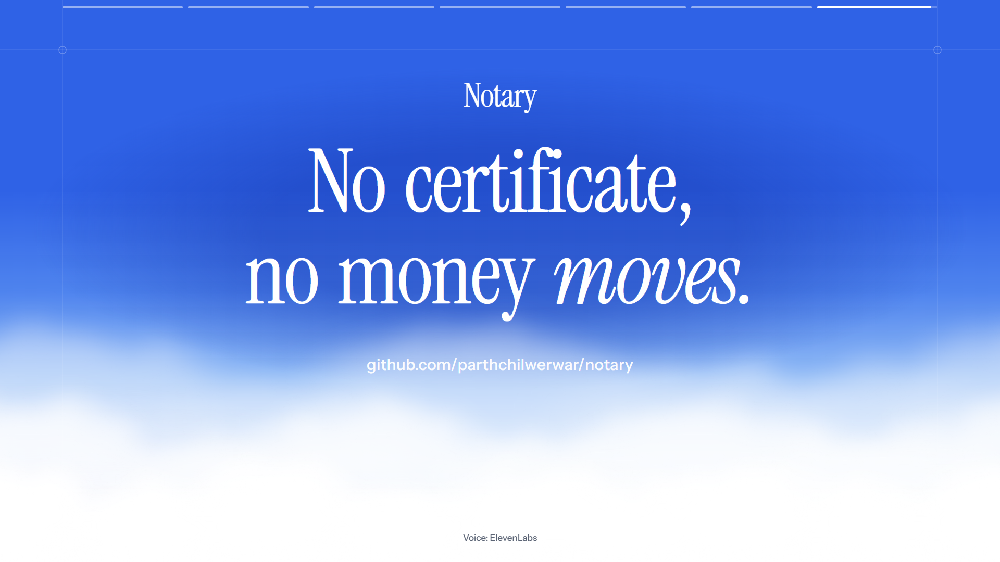
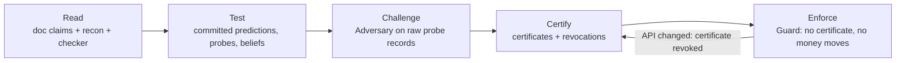

# Notary

**No certificate, no money moves.**

Notary is an AI billing agent that won't touch money until it has proven how its tools actually behave. It reads the API docs, tests every promise with pre-registered experiments, has a second model try to refute the results, and only then issues a **certificate**. Every refund, credit or plan change needs a certificate for the behaviours it depends on; anything uncovered is held for a person.

*Read → Test → Challenge → Certify → Enforce.* Built for **neatHack 2026**.

## Demo video (2:55)

[](https://github.com/parthchilwerwar/notary/raw/main/docs/media/notary-submission.mp4)

▶ **[Watch the demo video](https://github.com/parthchilwerwar/notary/raw/main/docs/media/notary-submission.mp4)** · captions: [`notary-submission.srt`](docs/media/notary-submission.srt) · 15-second showreel: [`notary-showreel.mp4`](https://github.com/parthchilwerwar/notary/raw/main/docs/media/notary-showreel.mp4)

The video covers what the organizers asked for: the problem Notary solves, how neatlogs was used to look into and resolve the incidents the agent ran into, and how Entire and cfo.ai are part of the project. Narration: ElevenLabs.


| Run transcript | Certificates | Incidents | Business |
| --- | --- | --- | --- |
|  |  |  |  |

## The problem

AI agents are starting to move real money: refunds, credits, plan changes. They learn how from API documentation, and they trust it. But docs and real APIs disagree. A page can say an amount is in units when it's in cents, that a timed-out request wasn't processed when it was, or that a lookup returns an empty result when it errors. None of these crash anything: every trace looks green, and the damage turns up later as a double or wrong refund.

We pointed Notary at two real APIs. **Crustdata's own docs were wrong in 3 places**: a no-match company lookup returns **400** where the docs promise 200 with an empty result (on both `/company/enrich` and `/company/identify`), and invalid fields return **403**, not 400 ([incidents](packages/web/public/incidents/notarize-crustdata-20261012T011404Z.json)). An agent that trusts the docs breaks on exactly these cases.

## How it works: Read → Test → Challenge → Certify → Enforce

Deterministic code makes every decision. Models only propose explanations and review beliefs.

1. **Read.** Every concrete promise in the Crustdata and Dodo Payments docs becomes a machine-checkable claim. A recon sweep and a deterministic checker compare real responses with each claim.
2. **Test.** The **Reflector** proposes rival explanations; every prediction is sha256-hashed and committed **before** the API call, then the call runs and fixed verdict rules update a belief per claim.
3. **Challenge.** The **Adversary**, a stronger, different model, reads only the raw probe records and tries to refute each belief: uphold, narrow its scope, or downgrade it.
4. **Certify.** What survives becomes a **certificate**: the claim, the doc text, the verdict, its scope, the evidence and a content hash. If the API changes later, the certificate is revoked.
5. **Enforce.** The **Guard** wraps every Dodo and Crustdata call. A money action runs only if every certificate it depends on is active; otherwise it's held for a person with an evidence pack.



**Notary Chat** answers questions about runs, certificates and approvals with citations to the exact records. It is read-only and can never move money.

## How each sponsor is used

| Sponsor | How Notary uses it | Evidence |
| --- | --- | --- |
| **neatlogs** | Every run is one neatlogs trace: an AGENT span per agent (Executor, Reflector, Adversary, Notary Chat), LLM spans for every model call, TOOL spans for every API call, GUARDRAIL spans for the Guard and EVALUATOR spans for verdicts. Each probe's prediction is logged with its hash before the call. We used these traces to look into each incident and check how it was resolved: the inconclusive Crustdata probe that Notary abstained on, and the four Dodo beliefs the Adversary narrowed and Notary certified only in their narrower scope. | Traces `9db41ecd43406cef291c93ef8c9ab1cd` (Crustdata run) and `a0e6fda50d71a9eb2fec0f04843bff4d` (Dodo run), on the probe records and [incidents](packages/web/public/incidents/); [`src/trace/`](packages/core/src/trace/index.ts) |
| **Entire** | Entire checkpoints the Claude Code sessions that built this repo, tying each commit to the session that wrote it. Notary also uses Entire's code graph (`notary guards coverage --backend entire`) to prove that every call that can move money goes through a guard. | 7 checkpoints and **0 unguarded call sites** (33 sites: 26 guarded, 7 raw by design): [`evidence/entire.json`](packages/web/public/evidence/entire.json), [`docs/ENTIRE.md`](docs/ENTIRE.md) |
| **cfo.ai** | Notary measures what certainty costs from its real runs and exports those costs to cfo.ai as a data source (`export/cfo-inputs.csv`); it connects to cfo.ai's MCP server (workspace sign-in over OAuth) to sync the business plan back into the dashboard's Business tab. | $0.0316 + 15.5 Crustdata credits per run, $0.0253 per certificate: [`economics.json`](packages/web/public/economics.json), [`docs/BUSINESS.md`](docs/BUSINESS.md). The plan sync is connected; no plan has been imported yet |
| **Crustdata** | Company enrichment, so the agent knows who each customer is and applies the right policy. First API notarized (11 claims), with a per-run credit budget. | Live run: 62 credits, 3 doc contradictions found, 1 certificate |
| **Dodo Payments** | Where the money moves: refunds, credits and plan changes, in **test mode only** (the client refuses to start otherwise). Second API notarized (15 claims). | 4 certificates: page size max 100 on payments and refunds, wallet credits in minor units (USD only), wallet idempotency key |
| **AWS** | Notary is built to deploy on AWS: scripts for a read-only hosted API on ECS Express Mode ([`deploy/aws/`](deploy/aws/), [`docs/DEPLOY_AWS.md`](docs/DEPLOY_AWS.md)), with Amazon Bedrock as a drop-in model provider. | Credentials verified for us-east-1; the deploy has not been run yet (it creates billable resources) |
| **LiteLLM** | All model calls go through a LiteLLM gateway: Claude Sonnet as Reflector and Notary Chat, Claude Opus as Adversary, Claude Haiku as Executor. `NOTARY_MAX_USD` caps spend. | `pnpm notary doctor --llm` passes all four roles |

## What Notary proved

- **3 documented Crustdata claims didn't hold**, caught by the deterministic checker on a real run.
- **5 certificates** (1 Crustdata, 4 Dodo Payments), **each one narrowed by the Adversary** rather than rubber-stamped ([`certificates/report.json`](packages/web/public/certificates/report.json), [`export/REPORT.md`](export/REPORT.md)).
- **Every prediction committed before its call**, on all 19 live probes.
- **0 unguarded money calls**, proven over Entire's code graph and the TypeScript checker.
- **About $0.03 of model spend and 15 Crustdata credits per run.**
- **Replays reproduce runs exactly, offline**, with no API keys.
- On Notary's test suite (planted API quirks, documented in [`docs/EVALUATION.md`](docs/EVALUATION.md#evaluation-suite)), the agent without Notary made 9 unsafe money moves; with Notary, 0, and 9 refunds were held for review.

## Try it

```bash
pnpm install
pnpm notary --help
pnpm --filter @notary/web dev
```

The dashboard opens at `http://127.0.0.1:5173/app` and replays the recorded runs; add `pnpm notary serve` for live mode. Full setup, keys, recording real runs and the CLI reference: [`docs/DEVELOPMENT.md`](docs/DEVELOPMENT.md).

## Honest limits

- **No real queue run yet.** The naive-vs-guarded comparison on real Dodo needs a seeded test world (12 hosted test-card checkouts by a person), so the 9 → 0 result comes from the test suite only.
- **The 3 Crustdata contradictions aren't certified yet** (two never probed, one inconclusive), so Notary holds anything that depends on them.
- **cfo.ai plan not imported yet**, and the **AWS deploy has not been run**.
- **Entire was enabled late** (Oct 12), so earlier commits have no checkpoints.

More in [`docs/DEVELOPMENT.md`](docs/DEVELOPMENT.md) and [`docs/AUDIT.md`](docs/AUDIT.md).

## Timeline

The Luma page and the organizers' Oct 9 email give the start as 12:00 AM IST, Oct 10, 2026 (the hackathon website says 12:30 PM IST). The first commit is Oct 10, 02:49:08 IST; planning docs (specs only, no code) were written on Oct 9. Details: [`hackathon.md`](hackathon.md).

## Repo

- [`packages/core`](packages/core/): the agent, CLI, schema and tests
- [`packages/web`](packages/web/): landing page and dashboard
- [`packages/showreel`](packages/showreel/): the demo video and showreel, built in Remotion
- [`docs/`](docs/): [DEVELOPMENT](docs/DEVELOPMENT.md), [ARCHITECTURE](docs/ARCHITECTURE.md), [DECISIONS](docs/DECISIONS.md), [EVALUATION](docs/EVALUATION.md), [BUSINESS](docs/BUSINESS.md), [ENTIRE](docs/ENTIRE.md), [AUDIT](docs/AUDIT.md), [PRD](docs/PRD.md)

Built with Claude Code, Codex, neatlogs, Entire, cfo.ai, Crustdata, Dodo Payments, LiteLLM and AWS.
