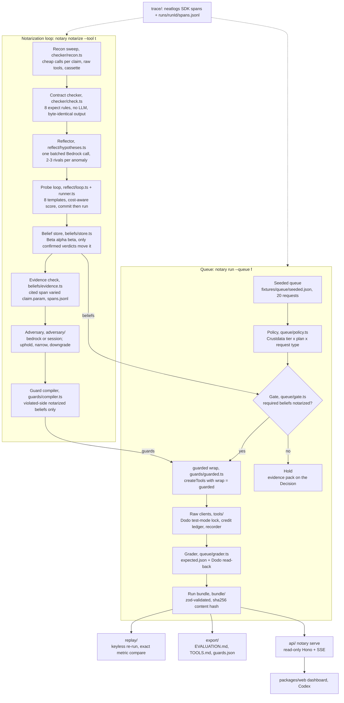

# Notary: Architecture (as built)

This document describes the code in `packages/core` at the end of P8. It is derived from [`TDD.md`](TDD.md) and corrected to match the code. Where the two differ, the [last section](#where-the-tdd-and-the-code-differ) lists each difference with its [`DECISIONS.md`](DECISIONS.md) entry.

**Status:** no live run has been recorded (no API keys). Everything below is implemented and unit-tested against doubles and test-only cassettes. Live paths stop with `BLOCKED: …` (exit 3) before any network call. See [`EVALUATION.md`](EVALUATION.md).

## At a glance

No money call reaches Dodo without passing through `guarded()`. Two loops share one SQLite store. Detection, verdicts, belief math, gating, guards, grading and metrics are deterministic code. Models only propose hypotheses (reflector) and review beliefs (adversary).

## Stack

| Layer | As built | TDD said |
| --- | --- | --- |
| Runtime | Node 24.14.1 (`engines.node >=22`) | Node 22 ([#1](DECISIONS.md)) |
| Packages | pnpm workspace: `@notary/core`, `@notary/web` | same |
| Validation | zod 4 (`src/schema/`, the dashboard contract) | same |
| State | `node:sqlite` `DatabaseSync`, single file `packages/core/runs/notary.sqlite` | `better-sqlite3` ([#34](DECISIONS.md)) |
| HTTP | Node global `fetch` (undici) + cassette recorder | `undici` ([#16](DECISIONS.md)) |
| Models | `@aws-sdk/client-bedrock-runtime` Converse, temperature 0 | same ([#35](DECISIONS.md)) |
| Tracing | `neatlogs` TS SDK 1.1.26 via `trace({attributes})` + local JSONL sink | `init/span/trace/log` ([#6](DECISIONS.md)) |
| Local API | hono 4.13 + @hono/node-server 2.1 | same ([#57](DECISIONS.md)) |
| CLI | commander 15, run via `tsx` | same |
| Env | `process.loadEnvFile()` (no dotenv) | — ([#2](DECISIONS.md)) |
| Tests | vitest (counts in [`EVALUATION.md`](EVALUATION.md#checks-that-dont-need-api-keys)) | same |

## Module map (`packages/core/src/`)

| Dir | Purpose | Key exports | Files |
| --- | --- | --- | --- |
| `cli.ts` | commander entry point. Loads `.env` except for keyless invocations (`replay`, `eval … --replay`) | `buildProgram`, `isKeylessInvocation` | `cli.ts`, `errors.ts` |
| `schema/` | zod types shared with `packages/web`. Imports only zod. `bundle.ts` is **frozen** (end of P1) | `RunBundleSchema`, `BundleIndexSchema`, `ClaimSchema`, `ProbeSchema`, `BeliefSchema`, `GuardSchema`, `DecisionSchema`, `DefectClassSchema`, `ExpectRuleSchema` | `anomaly belief bundle claim common decision guard hypothesis probe queue index` |
| `contracts/` | Documented promises: 11 Crustdata + 15 Dodo claims quoted from the docs, each with its cheapest recon steps. `priors-map.ts` gives the suspected defect class per claim | `allContracts`, `contractFor`, `claimById`, `RECON_PATH_PARAMS`, `SUSPECTED_CLASS` | `crustdata dodo priors-map types index` |
| `checker/` | Deterministic doc-vs-wire checker (no clock, no randomness), field-path resolver, recon sweep, `notarize --recon-only` | `checkClaim`, `checkAll`, `runRecon`, `reconOnly`, `RUNS_DIR` | `check path recon notarize index` |
| `reflect/` | The notarization loop: batched hypotheses, probe templates, cost-aware score, commit-then-run, verdict rules, full `notarize`, `--compare-priors` | `proposeHypotheses`, `runProbeLoop`, `runProbe`, `rankDesigns`, `decideVerdict`, `notarize`, `comparePriors`, `TEMPLATES` | `hypotheses loop runner score verdict notarize compare-priors templates/{boundary_sweep, unit_roundtrip, retry_after_timeout, pagination_completeness, write_then_read, unknown_param, type_edge, header_burst, common, types, index}` |
| `beliefs/` | Beta-binomial math, belief store and lifecycle, independence fingerprints, FR-10 evidence check, beliefs phase, transfer priors, drift un-learning | `BeliefStore`, `confidenceOf`, `checkEvidence`, `loadSpanRecords`, `runBeliefsPhase`, `transferPriors`, `replayDrift`, `designFingerprint` | `math store params evidence phase priors drift index` |
| `adversary/` | Reviews candidate beliefs from raw probe records only (reflector prose is asserted absent). Two backends | `reviewBelief`, `buildEvidencePacket`, `reviewWithBedrock`, `reviewWithSession`, `REVIEWER_SYSTEM_PROMPT` | `index bedrock session prompt evidence-packet types` |
| `guards/` | Compiler (beliefs → guards), registry (SQLite or in-memory, retire-on-unlearn), the `guarded()` wrap, per-decision context, read-back, coverage command | `compileGuards`, `GuardRegistry`, `wireRetirement`, `guarded`, `withGuardContext`, `readBack`, `GuardBlockedError`, `UnknownWriteOutcomeError`; `coverage.ts` is imported only by the CLI (it loads the TS compiler) | `compiler registry guarded context readback errors coverage index` |
| `queue/` | Policy table, seed plan and manifest, required-beliefs map, gate, executor (naive and guarded), deterministic grader, per-item run state, `notary run` | `decidePolicy`, `tierFromCompany`, `REQUIRED_CLAIMS`, `REQUIRED_GAPS`, `createGate`, `executeQueue`, `gradeRun`, `RunStateStore`, `runQueue`, `SEED_PLAN`, `resolveRef` | `policy seed-plan manifest required gate executor grader run-state run` |
| `tools/` | The **only** public tool surface. Raw Crustdata and Dodo clients are not exported; `createTools({wrap})` exposes each method as `wrap(op, raw.bind(client))`. Also the recorder, ledger, errors and drift fixtures | `createTools`, `identityWrap`, `CRUSTDATA_OPS`, `DODO_OPS`, `Recorder`, `loadCassette`, `CreditLedger`, `makeDriftFixture`, `MissingCredentialError`, `TestModeLockError`, `BudgetExceededError`, `CassetteMissError` | `index client crustdata dodo recorder ledger errors drift-fixture` |
| `llm/` | Bedrock client with three roles, per-role usage and USD, model roster with separation of duties | `LlmClient`, `UsageMeter`, `resolveModels`, `ModelConfigError`, `resolvePrice`, `costUsd` | `client roles pricing index` |
| `trace/` | neatlogs wrapper. `withSpan` stamps `notary.*` attributes. The local span sink writes `runs/<runId>/spans.jsonl` even when neatlogs is off. `notary doctor` | `initTracing`, `withSpan`, `traceLog`, `setSpanSink`, `shutdownTracing`, `runDoctor` | `index doctor` |
| `store/` | SQLite store: anomalies, hypotheses, probes with immutable predictions | `openDb`, `NotaryDb`, `predictionHash`, `PredictionImmutableError`, `DEFAULT_DB_PATH`, `runDir` | `db` |
| `bundle/` | Canonical JSON + pure-JS sha256 (also runs in the browser), bundle writer + index, synthetic SAMPLE bundle | `canonicalJson`, `computeContentHash`, `finalizeBundle`, `verifyBundle`, `writeBundle`, `buildSampleBundle` | `hash index sample` |
| `replay/` | Keyless replay: inputs record and store snapshot, model-call cassettes, cassette pins | `runReplay`, `replayBundle`, `RecordingLlm`, `ReplayLlm`, `saveInputs`, `snapshotStore`, `restoreStore`, `pinRef`, `loadPinned` | `index inputs llm-cassette pins` |
| `eval/` | All metrics in one place (null when not computable), exact comparison, noise floor | `consolidateMetrics`, `beliefPrecision`, `unguardedCallSitesMetric`, `compareExact`, `runNoiseFloor`, `computeNoiseFloor` | `metrics noise-floor` |
| `export/` | `notary export`: collect real, hash-verified bundles, then render `TOOLS.md`, `guards.json` and `EVALUATION.md`, and run the keyless checks | `runExport`, `collectBundles`, `renderEvaluationMd`, `renderToolsMd`, `buildGuardsJson`, `runDefaultChecks`, `commandFor` | `index collect evaluation tools-md guards-json checks commands compare` |
| `api/` | Read-only local API and in-process event bus | `startServer`, `createApp`, `emitEvent`, `subscribe`, `NOTARY_EVENT_TYPES` | `server bus` |

Outside `src/`: `packages/core/scripts/seed-dodo.ts` (seed the Dodo test world), `packages/core/scripts/make-drift.ts` (drift fixture CLI), `scripts/check-secrets.mjs` (pre-commit secret scan), `scripts/fresh-clone-check.mjs` (fresh-clone keyless replay), `packages/core/test/` (vitest suites).

## Data flow: `notary notarize --tool <t>`

From [`reflect/notarize.ts`](../packages/core/src/reflect/notarize.ts):

1. **Preflight.** It returns BLOCKED (exit 3) when the tool key (live), `NOTARY_MODEL_REFLECTOR` or `AWS_REGION` is missing, and also when `--priors-from` has no source bundle. Equal reflector and adversary ids fail with `ModelConfigError`.
2. **Recon.** `runRecon` drives each contract entry's recon steps through `createTools()` **without** a guard wrap, so it sees raw behavior (raw-by-design, [#56](DECISIONS.md), [#62](DECISIONS.md)). Exchanges are recorded to cassette `<runId>-recon`. Setup steps feed `$from` refs and are never checked ([#25](DECISIONS.md)).
3. **Checker.** `checkAll` evaluates each claim's `expect` rule (`maxItems`, `type`, `unit`, `statusOnError`, `idempotentOnRetry`, `errorOnUnknownParam`, `fieldPresent`, `consistentWithin`) on that claim's own recon exchanges ([#26](DECISIONS.md)) and emits Anomalies.
4. **Hypotheses.** All open anomalies go into one reflector call. The JSON reply is zod-validated, and a malformed reply fails safe. The model proposes only `{class, statement, distinguishingTest}`. Predictions come from each template's class table, in code ([#38](DECISIONS.md)).
5. **Probe selection.** Templates are ranked by `score = separated rival classes / (credits + λ·calls)`, with λ = `NOTARY_PROBE_LAMBDA` (default 1). The model's `distinguishingTest` doesn't pick the template ([#39](DECISIONS.md)).
6. **Commit, then run** (`runner.ts`). The runner reserves estimated credits, then writes the prediction, its sha256 and `committedAt` to SQLite and opens the probe span with `notary.prediction`. Only then does it execute the treatment and control variants. `recordResult` re-verifies the hash ([#40](DECISIONS.md)).
7. **Verdict** (`verdict.ts`). `confirmed` when the observation matches exactly one hypothesis's prediction and contradicts every rival. Otherwise `inconclusive`, `uninformative` (empty or null, or a sweep that saw nothing), `invalid` (control and treatment read the same where they should differ), or `refuted`. If all rivals are refuted, it re-proposes once and then abstains.
8. **Beliefs.** One belief per claim, starting from Beta(1,1) or a transfer prior. Only confirmed verdicts move it: honored adds to α, any defect class adds to β ([#44](DECISIONS.md)). The loop keeps probing a claim until it reaches candidate or hits `NOTARY_MAX_PROBES_PER_CLAIM` (default 5), the run cap (30 probes) or the budget, then abstains ([#46](DECISIONS.md)). Candidate means `confidence = P(θ>0.5) > 0.9` (honored) or `< 0.1` (violated) with ≥ 2 independent probes. Independence requires a different probe id **and** a different design fingerprint ([#43](DECISIONS.md), [#45](DECISIONS.md)).
9. **Evidence check (FR-10).** Each cited probe must exist for that claim, have a matching span in `runs/<runId>/spans.jsonl`, and have actually varied `claim.param` ([#48](DECISIONS.md)). Invalid evidence never counts.
10. **Adversary.** It reviews each candidate from an evidence packet of raw probe records with secrets scrubbed. `uphold` → notarized; `narrow` → notarized with a narrowed scope; `downgrade` → back to hypothesis; a malformed reply or failure leaves it a candidate ([#51](DECISIONS.md)).
11. **Bundle.** `packages/core/runs/<runId>/<runId>.json` (kind `notarize`) with consolidated metrics, including `probes_to_candidate_<claimId>`. The live run also writes `<runId>-probes`, `<runId>-llm` and `<runId>-inputs` and pins all four cassettes in `bundle.cassettes` as `name@sha256` ([#63](DECISIONS.md)). It refreshes the `recon-<tool>` / `probes-<tool>` aliases.

`--priors-from <tool>`: base rate per defect class from the source tool's settled beliefs. Prior = Beta(1 + s(1−r), 1 + s·r), with s = `NOTARY_PRIOR_STRENGTH` (default 2, at most 2 so two contrary probes always outweigh the prior; AUDIT-22), applied only to new beliefs ([#58](DECISIONS.md)). `--compare-priors` replays the same probes cassette twice and records `probes_to_candidate_with_priors` / `_without_priors` ([#59](DECISIONS.md)).

## Data flow: `notary run --queue <file>`

From [`queue/run.ts`](../packages/core/src/queue/run.ts) and [`queue/executor.ts`](../packages/core/src/queue/executor.ts):

1. Load the queue (zod) and resolve seed handles (`cust:` / `pay:` / `sub:` / `prod:`) through `fixtures/seed/manifest.json`, which only a live seed writes. Missing keys or a missing manifest give BLOCKED, and nothing is written.
2. **Ground truth before:** every seeded customer's refunds and payments, paginated to an *empty* page.
3. **Guarded only:** compile guards from the store's notarized beliefs into a `GuardRegistry`, wire retire-on-unlearn, build tools with `createTools({wrap: guarded(registry)})`, create the gate, and persist `run_meta`.
4. Per item, inside `withGuardContext`: Crustdata enrichment (cached per domain) → `tierFromCompany` → `decidePolicy` (tier × plan × request type; [#29](DECISIONS.md)). For an irreversible action the **gate** checks `REQUIRED_CLAIMS` ([#53](DECISIONS.md)). Any belief not notarized means **held** with an evidence pack: missing beliefs, related probes, span ids, and `runs/<runId>/spans.jsonl#trace=<id>` receipts. Otherwise the write goes through the guards. The pending write is persisted (`run_items.in_flight`) before it is sent ([#55](DECISIONS.md)).
5. **Naive** (`--naive`) uses `identityWrap`: no gate, no guards, one page of refunds as the precheck, one blind retry on timeout or 5xx. It is doc-trusting with no deliberate bugs ([#31](DECISIONS.md)).
6. **Ground truth after → grader.** Unsafe actions (`duplicate`, `wrong_unit`, `missed_existing_refund`), decision accuracy against `expected.json`, automation rate, holds and escalations. No model output is read.
7. Bundle to `packages/core/runs/<runId>/` plus a copy in `packages/web/public/bundles/`. Bus events `decision` and `run.finished`.

`--resume`: an in-flight item is read back (fully paginated). Landed → executed with no resend; proven not landed → reprocessed; undecidable → held.

## Run bundle (frozen schema summary)

[`src/schema/bundle.ts`](../packages/core/src/schema/bundle.ts), frozen at the end of P1 ([#18](DECISIONS.md)):

| Field | Meaning |
| --- | --- |
| `runId`, `kind` (`run` \| `notarize` \| `sample`), `variant` (`naive` \| `guarded` \| `notarize` \| `sample`), `mode` (`live` \| `replay`), `sample` | What produced it |
| `disclosure[]` | Labels the dashboard must show (seeded queue, sample data, drift fixture, required-belief gaps) |
| `startedAt`, `finishedAt?`, `status` (`completed` \| `stopped_budget` \| `blocked` \| `failed`), `stopReason?`, `seed` | Run lifecycle |
| `tool?`, `priorsFrom?`, `replayOf?` | Notarize target, prior source, the original runId of a replay |
| `queue[]`, `decisions[]` | Requests and one Decision per item: policy outcome, action, required and missing beliefs, status (`executed` \| `held` \| `escalated` \| `denied`), `guardsApplied`, `effects` (every call, reads included), `evidencePack`, `grade`, `enrichment` |
| `claims[]`, `anomalies[]`, `hypotheses[]`, `probes[]` | Notarization records. A probe carries its `control`, `prediction`, `predictionHash`, `committedAt`, `observed` and `verdict` |
| `beliefs.before[]` / `beliefs.after[]`, `beliefEvents[]` | Belief state around the run and its append-only event log |
| `guards[]` | Including retired ones (`active: false`, `retiredAt`) |
| `usageByRole` | Tokens, USD and calls for executor, reflector and adversary (all three always present) |
| `credits` | `{byEndpoint, total, budget}` |
| `metrics` | `Record<string, number \| null>`, where null means not computable. Keys from [`eval/metrics.ts`](../packages/core/src/eval/metrics.ts) `HEADLINE_KEYS` |
| `noiseFloor?` | Per-metric max − min from `eval noise-floor` |
| `traceLinks` | trace id → link. Today these are local `spans.jsonl` receipts from evidence packs, and empty on notarize bundles |
| `cassettes[]` | `name@sha256` pins |
| `contentHash` | sha256 of `canonicalJson(bundle without contentHash)`, recomputed on every load (`verifyBundle`, CLI, API, dashboard) |

## Storage (`node:sqlite`, `packages/core/runs/notary.sqlite`, gitignored)

| Table | Owner | Notes |
| --- | --- | --- |
| `anomalies` | `store/db.ts` | Per `(run_id, id)`, with trace and span ids |
| `hypotheses` | `store/db.ts` | `round` 0 = first proposal, 1 = re-proposed after refutation |
| `probes` | `store/db.ts` | Trigger `probes_prediction_immutable` rejects changes to prediction, hash, `committed_at`, params, control, template, hypotheses or claim. Trigger `probes_no_delete` |
| `beliefs` | `beliefs/store.ts` | One row per claim: α, β, confidence, status, side, scope, adversary, prior, `probes_to_candidate` |
| `belief_probes` | `beliefs/store.ts` | Which probes moved which belief: verdict, side, fingerprint, cited, evidence validity |
| `belief_events` | `beliefs/store.ts` | Append-only: update and delete triggers abort |
| `guards` | `guards/registry.ts` | Every compiled guard, active or retired |
| `run_meta`, `run_items` | `queue/run-state.ts` | Per guarded run: the ground-truth snapshot before the run, and per-item state `pending` / `in_flight` / `done` with the last write for read-back |

Files next to the store: `runs/<runId>/<runId>.json` (bundle), `runs/<runId>/spans.jsonl` (local span sink), `runs/noise-floor.json`. Cassettes live in `packages/core/fixtures/cassettes/` (not gitignored) and drift fixtures in `packages/core/fixtures/drift/`.

## Replay and cassettes

- **Recorder** (`tools/recorder.ts`). Live mode calls the network, redacts the exchange (auth headers, secret-named fields, `.env` values whose names look secret), records it and returns the **redacted** body, so live and replay decide identically ([#17](DECISIONS.md)). Exchanges are keyed by `requestHash` + `occurrence`. Each cassette has a content hash. Replay serves from the cassette and throws `CassetteMissError` (op, URL, hash, occurrence) on a miss.
- **Per live run:** tool cassettes (`<runId>-recon`, `<runId>-probes`, or the run's `run-<variant>-<stamp>`), the model cassette `<runId>-llm` (`RecordingLlm`), and the inputs record `<runId>-inputs` (identity runId, parameters, file sha256s, priors source, pre-run store snapshot). All are pinned in `bundle.cassettes`.
- **`notary replay`** (`replay/index.ts`). It verifies every bundle's hash, then each recorded live bundle's pins and cassette hashes. It restores the store snapshot and re-runs the same pipeline with **no environment**, serving tool and model traffic from cassettes, and probe ids derive from the recorded runId ([#63](DECISIONS.md)). Then it compares every metric exactly, and the records too: probes, hypotheses, anomalies, beliefs and decisions (`replay/records.ts`, AUDIT-19). Exit 0 = all match; 1 = miss, tamper, pin mismatch, changed queue file, resumed run or mismatch; 3 = nothing recorded ([#64](DECISIONS.md)).
- **`--drift <fixture>`** replays the notarize bundle whose probe cassette the fixture was copied from (matched by content hash), then runs `replayDrift`. It prints each affected belief's confidence trajectory and the guards retired on `unlearned` ([#60](DECISIONS.md)).
- **Discovery** scans `packages/core/runs/` (gitignored) and `packages/web/public/bundles/` (committed). A fresh clone can therefore replay only bundles that `notary export` copied to the dashboard directory.

## Guards: kinds and compiler mapping

Only **notarized** beliefs on the **violated** side compile. A notarized honored belief satisfies the gate as is ([#52](DECISIONS.md)).

| Belief (defect class / claim) | Compiles to | `guarded()` behavior |
| --- | --- | --- |
| `unit_mismatch` | `transform` with the ratio from the `unit_roundtrip` probes. No ratio or an inconsistent one → `block` | Scale `rule.param` by `rule.scale`; refuse a non-integer result |
| `idempotency_hazard` | `retry_policy` + `precheck` | Snapshot, call once. On timeout or 5xx read back: landed → return the read-back; proven not landed → retry up to `maxAttempts`; unknown → `UnknownWriteOutcomeError` (held) |
| `silent_truncation` (list ops) | `paginate_fully` | Page until an **empty** page; refuse if `page_number` stalls or the page cap is hit |
| `undocumented_flag` | `require_param` | Add the rule's default when the param is missing; refuse when there is none |
| refunds[]-listing claims (`REFUND_EXISTENCE_CLAIMS`) | `precheck` (existing refund) | The payment's `refunds[]` plus the customer's refunds paginated to an empty page. Refuse on any non-failed refund or an incomplete listing. Plan changes: refuse if a change is already scheduled |
| any other class | `block` | Refuse with the guard's reason (`GuardBlockedError` → held) |

Guard ids are deterministic. Each firing is appended to the Decision's `guardsApplied`, and the guard's own reads go to `effects`. The registry is consulted on every call, so a guard retired mid-run stops applying immediately.

**Coverage** (`notary guards coverage`, FR-17). Every public raw-client method must be in the ops table and reachable only through `wrap(op, …)` inside `createTools`. Every `createTools()` call must pass a real wrap, unless it is in `RAW_BY_DESIGN`: recon, probing, seeding, and the naive baseline's identity wrap ([#62](DECISIONS.md)). Each entry names the enclosing function and the exact number of sites it covers, so another raw call in the same file is still UNGUARDED (AUDIT-10). Backends: `entire` (`entire graph neighbors`, unverified, [#61](DECISIONS.md)) and `tsc` (a TypeScript-checker walk over `src` + `scripts`). `auto` picks `entire` only when it is on PATH. Current result: [`EVALUATION.md`](EVALUATION.md#checks-that-dont-need-api-keys).

## Adversary backends

Both backends use the same fixed reviewer prompt ([`adversary/prompt.ts`](../packages/core/src/adversary/prompt.ts)) and receive the same evidence packet: belief, claim, and raw probe records (template, params, control, predictions with defect classes, observed, verdict, trace ids). Hypothesis statements and reflector prose are excluded and asserted absent ([#49](DECISIONS.md)). Replies are zod-validated, and any failure leaves the belief a candidate.

- **`bedrock`** (default): one `complete` call with role `adversary` (`NOTARY_MODEL_ADVERSARY`, which must differ from the reflector, including across `us.`/`global.` prefixes, [#37](DECISIONS.md)).
- **`session`**: writes `adversary/inbox/<beliefId>.json` and runs headless `claude -p … --output-format json --tools Read,Write --permission-mode dontAsk --strict-mcp-config --disable-slash-commands`, which may read only the inbox file and write only `adversary/verdicts/<beliefId>.json`, with `.env` reads disallowed. The inbox and verdict files are committed as `adversary: <verdict> <beliefId>` so Entire can checkpoint the review. It hasn't run live ([#50](DECISIONS.md)).

## Local API and dashboard contract

`notary serve` binds `127.0.0.1:8787` by default and is read-only (writes → 405, localhost-only CORS):

- `GET /api/bundles` returns index entries merged from `packages/core/runs/` and `packages/web/public/bundles/`.
- `GET /api/bundles/:id` re-verifies the bundle on every read. A hash mismatch returns 200 with `X-Notary-Hash-Mismatch: 1` and an `error` field.
- `GET /api/stream` is SSE (`decision`, `probe.committed`, `probe.verdict`, `belief.changed`, `run.finished`) with `Last-Event-ID` replay from a bounded ring buffer.

The dashboard (`packages/web`, built by Codex) depends only on `src/schema/bundle.ts` and `public/bundles/`. Today it holds the synthetic `sample-42.json` and a placeholder README.

## Where the TDD and the code differ

| TDD | Code | DECISIONS |
| --- | --- | --- |
| Node 22 LTS | Node 24 (`>=22`) | [#1](DECISIONS.md) |
| `better-sqlite3` | `node:sqlite` (ExperimentalWarning on Node 24) | [#34](DECISIONS.md) |
| `undici` fetch | Node global fetch | [#16](DECISIONS.md) |
| neatlogs `span()` with metadata | `trace({attributes})`; `withSpan` stamps `notary.runId` itself | [#6](DECISIONS.md) |
| Guard kinds: block, transform, require-param, retry-policy | `transform, require_param, precheck, retry_policy, paginate_fully, block` | [#4](DECISIONS.md) |
| Bundle field list | Adds `kind`, `variant`, `sample`, `disclosure`, `status`/`stopReason`, `hypotheses`, `beliefEvents`, `noiseFloor`, `cassettes`, `replayOf`, Decision `effects`/`evidencePack`/`grade`/`enrichment`, Guard `active`/`retiredAt`, Probe `control`/`predictionHash`; metrics may be null | [#18](DECISIONS.md) |
| Bundles at `export/bundles/<runId>.json` | `packages/core/runs/<runId>/<runId>.json` (gitignored), with copies in `packages/web/public/bundles/` (by `run` and `export`) | [#20](DECISIONS.md), [#67](DECISIONS.md) |
| "P(holds) < 0.1 / > 0.9" | `confidence = P(θ > 0.5)` under Beta(α,β); 3 same-side confirmed probes from Beta(1,1) | [#43](DECISIONS.md) |
| "at least two independent probes" | Different probe id **and** design fingerprint | [#45](DECISIONS.md) |
| Probe until settled (implicit) | Loop per claim until candidate or cap 5 / budget, then abstain | [#46](DECISIONS.md) |
| Model gives a distinguishing test | Template chosen by score; predictions from code class tables | [#38](DECISIONS.md), [#39](DECISIONS.md) |
| Evidence via `neatlogs-cli` | `runs/<runId>/spans.jsonl` (CLI not installed / unverified) | [#48](DECISIONS.md) |
| Required beliefs: rounding, plan-change semantics | No doc claim exists. Proxy claim + client-side floor; explicit `effective_at: "immediately"`; disclosed in the bundle | [#22](DECISIONS.md), [#53](DECISIONS.md), [#54](DECISIONS.md) |
| Credit or discount action | Wallet ledger entry (discounts are checkout codes) | [#13](DECISIONS.md) |
| Dodo idempotency | No `Idempotency-Key` header documented; retry safety must be probed | [#10](DECISIONS.md) |
| Test-mode lock refuses a live key | No documented key prefix: `NOTARY_MODE=test` + exact test base URL | [#15](DECISIONS.md) |
| Seed script creates payments | 11 hosted test-card checkouts by a human, the rest via `confirm:true` checkouts | [#28](DECISIONS.md) |
| Executor model handles the queue | Policy is plain code. The executor role is configured but not called | [#33](DECISIONS.md) |
| Coverage via entire-graph | `entire` backend implemented but unverified; `tsc` fallback used | [#56](DECISIONS.md), [#61](DECISIONS.md), [#62](DECISIONS.md) |
| Drift fixture exists | None until a real cassette is recorded; mechanism tested on a temp cassette | [#60](DECISIONS.md) |
| CLI: run, notarize, replay, export, guards coverage, serve | Also `eval noise-floor`, `doctor`, `notarize --recon-only/--replay/--adversary/--compare-priors/--priors-bundle`, `run --resume/--run/--replay`, `replay --drift`, `export --sample/...` | [#59](DECISIONS.md), [#66](DECISIONS.md) |
| Trace links to neatlogs | `traceLinks` hold local `spans.jsonl` receipts (run bundles) or are empty (notarize bundles) | not yet in DECISIONS |
