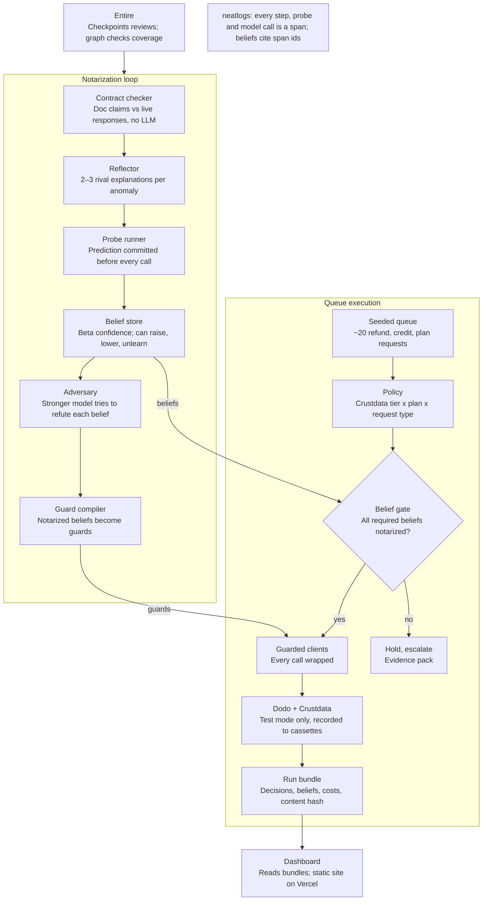

# Notary — Technical Design

Oct 10, 2026 · Parth

## Architecture at a glance

No money call reaches Dodo without passing a guard. Two loops share one belief store, and neatlogs traces every step.



The notarization loop turns doc claims into notarized beliefs and guards. The queue can only spend money through the gate and the guarded clients those beliefs feed. Probes call the same live APIs through the recorder, and every box emits neatlogs spans.

## Stack and repo layout

TypeScript on Node 22 throughout, in a pnpm workspace with two packages: `core` (agent, built in Claude Code) and `web` (dashboard, built in Codex).

| Layer | Choice | Why |
| --- | --- | --- |
| Runtime | Node 22 LTS | `neatlogs-cli` needs Node 22/24; avoids Bun/OTel compatibility risk |
| Package manager | pnpm workspaces | One repo, two packages, shared schema |
| Validation | zod | One schema for bundle, beliefs and API payloads, shared by core and web |
| State | SQLite via `better-sqlite3` | Beliefs, probes, runs; single file, easy to snapshot |
| HTTP clients | `undici` fetch + a recording layer | Cassettes for replay |
| Models | AWS Bedrock (`@aws-sdk/client-bedrock-runtime`) | Two tiers: executor and reflector/adversary |
| Tracing | `neatlogs` TS SDK (`init`, `span`, `trace`, `log`) | Spans per step and probe |
| Local API | Hono + SSE | Live mode for the dashboard |
| CLI | `commander` | `run`, `notarize`, `replay`, `export`, `serve` |
| Tests | vitest | Deterministic parts are unit-tested |
| UI | React + Vite + Tailwind | Static build on Vercel |

```
notary/
  PLAN.md                 phase checklist, committed at P0
  packages/
    core/
      src/
        cli.ts            run | notarize | replay | export | serve
        schema/           zod types: contract, anomaly, belief, probe, guard, decision, bundle
        contracts/        doc claims per tool (crustdata.ts, dodo.ts)
        checker/          deterministic doc-vs-wire comparison
        reflect/          batched hypotheses, probe templates, scoring, verdicts
        beliefs/          beta-binomial store, lifecycle, unlearn
        adversary/        stronger-model review + headless coding-agent runner
        guards/           compile beliefs -> guard functions; coverage check
        tools/            crustdata client, dodo client (test-mode lock), recorder
        queue/            policy, required-beliefs map, executor, escalation
        llm/              bedrock client, roles, per-role usage
        trace/            neatlogs init, span helpers, evidence-check reader
        bundle/           run bundle writer + content hash
        api/              hono server + SSE
      fixtures/           cassettes, seeded queue, drift fixture
      test/
    web/
      src/                screens read bundle JSON via shared zod schema
  export/                 TOOLS.md, guards.json, bundles/
  docs/                   ARCHITECTURE.md, EVALUATION.md
```

## Data model

Seven record types, all defined once in zod under `core/src/schema` and stored in SQLite; the run bundle is their JSON export.

| Record | Key fields | Notes |
| --- | --- | --- |
| Claim | `id`, `tool`, `operation`, `param`, `docText`, `expect` (machine-checkable rule), `docUrl` | One documented promise, hand-written from the real docs in P2 |
| Anomaly | `id`, `claimId`, `observed`, `expected`, `traceId`, `spanId` | Emitted only by the deterministic checker |
| Hypothesis | `id`, `anomalyId`, `class`, `statement`, `distinguishingTest` | 2–3 per anomaly; `class` from a fixed taxonomy |
| Probe | `id`, `hypothesisIds[]`, `template`, `params`, `prediction` (per hypothesis), `committedAt`, `observed`, `verdict`, `costCredits`, `traceId` | `prediction` is written before the call; immutable after |
| Belief | `id`, `claimId`, `statement`, `alpha`, `beta`, `confidence`, `status` (hypothesis, candidate, notarized, refuted, abstained, unlearned), `evidence[]` (probe + trace ids), `adversary` (verdict, reason, model, sessionId) | Status changes are appended to a `belief_events` log |
| Guard | `id`, `beliefId`, `operation`, `kind` (block, transform, require-param, retry-policy), `rule` | Compiled from notarized beliefs only |
| Decision | `id`, `requestId`, `policyOutcome`, `action`, `requiredBeliefs[]`, `missingBeliefs[]`, `status` (executed, held, escalated, denied), `guardsApplied[]`, `traceId` | One per queue item |

**Defect class taxonomy** (shared by hypotheses, guards and transfer priors): `silent_truncation`, `silent_coercion`, `unit_mismatch`, `undocumented_flag`, `eventual_consistency`, `idempotency_hazard`, `rate_limit`, `expiry`, `mislabelled_semantics`, `honored` (control).

**Run bundle** (`export/bundles/<runId>.json`): `runId`, `mode` (live or replay), `startedAt`, `seed`, `queue`, `decisions[]`, `claims[]`, `anomalies[]`, `probes[]`, `beliefs[]` (before and after), `guards[]`, `usageByRole` (executor, reflector, adversary: tokens and USD), `credits` (Crustdata by endpoint), `metrics`, `traceLinks`, `contentHash`. The hash is recomputed on load so a tampered bundle fails visibly.

## The notarization loop

Detection is deterministic and the model only explains; a belief becomes usable only after a pre-registered experiment settles it and a stronger model fails to refute it.

**1. Contract checker (no LLM).** Each claim carries a machine-checkable `expect` rule: `maxItems`, `type`, `unit`, `statusOnError`, `idempotentOnRetry`, `errorOnUnknownParam`, `fieldPresent`, `consistentWithin(ms)`. The checker runs on every recorded exchange and emits an Anomaly when the wire disagrees. Same exchanges in, same anomalies out.

**2. Batched hypotheses.** All open anomalies go to the reflector in one call. It returns JSON (validated by zod): 2–3 rival hypotheses per anomaly, each with a defect class and a distinguishing test drawn from the template list. One call is cheaper and lets the model see related anomalies together.

**3. Probe templates.** `boundary_sweep` (values around a documented limit), `unit_roundtrip` (create a known amount, read it back), `retry_after_timeout` (repeat a write, then list to count duplicates), `pagination_completeness` (count the same set two ways), `write_then_read` (timed reads after a write), `unknown_param` (send an unknown field or filter), `type_edge` (large numbers, edge dates), `header_burst` (rate limits, hard-capped).

**4. Probe selection.** Greedy, cost-aware score; the cost term uses real per-endpoint Crustdata credits and Dodo call counts.

```
score(t) = (rival classes t separates) / (credits(t) + λ · calls(t))
```

**5. Commit, then run.** The probe span opens in neatlogs with `notary.prediction` set per hypothesis and `committedAt` written to SQLite before the HTTP call. Predictions are immutable after that.

**6. Verdict rules.**

- Confirm a hypothesis only if the observation matches its prediction and contradicts every rival.
- Matches more than one rival: inconclusive, no belief update.
- Uninformative observation (empty result, null, a sweep that saw nothing): no update in either direction.
- Instrument check: every probe has a control variant; if control and treatment read the same where they should differ, the probe is invalid.
- All rivals refuted: re-propose once, using the refutation as evidence, then abstain.

**7. Confidence.** Each belief is a Beta(α, β) over "the doc claim holds", starting at Beta(1,1) or a transfer prior. Each informative observation adds to α (honored) or β (violated). Candidate when P(holds) < 0.1 (violation) or > 0.9 (honored) with at least two independent probes. Abstain when the budget ends between the thresholds. A later observation that crosses back over 0.5 moves a notarized belief to `unlearned` and retires its guard.

**8. Adversary.** A stronger Bedrock model receives the belief plus raw probe records, never the reflector's prose. It must answer: does the cited evidence actually test this parameter, what alternative is untested, and is the scope overclaimed (for example "global" from one key). Verdicts: uphold, narrow scope, or downgrade with reason. Two backends: `bedrock` (default) and `session`, a headless Claude Code run inside the repo whose verdict file is committed, so Entire checkpoints the review next to the belief.

**9. Transfer priors.** When probing tool 2, each claim's prior comes from the base rate of its defect class on tool 1 (for example, page-size claims start skeptical if Crustdata clamped silently). Measured as probes-to-candidate with and without priors.

## Queue execution and guards

Every queue item becomes a Decision; an irreversible action runs only through guarded clients and only when all its required beliefs are notarized.

**Policy.** Crustdata enrichment maps a customer's company to a tier (SMB, mid-market, enterprise) from headcount and funding fields. A small, readable policy table maps tier × plan × request type to an outcome (approve, partial, deny, escalate). The policy is plain code, not a prompt.

**Required beliefs per action** (final list fixed in P1 after confirming which Dodo test-mode endpoints exist):

| Action | Must be notarized before execution |
| --- | --- |
| Full refund | Refund amount unit; retry safety after timeout or 5xx; payment-list completeness (to find existing refunds); company-size field semantics (tier) |
| Partial refund | All of the above + amount rounding behavior |
| Plan change | Subscription change semantics (immediate vs period end); retry safety |
| Credit or discount | Unit and scope of the adjustment; retry safety |

**Guard kinds.** Compiled from notarized beliefs into a registry under `core/src/guards`:

- `transform`: rewrite a parameter (for example, convert units).
- `require_param`: add or demand a parameter (for example, an explicit filter or flag).
- `precheck`: read state before a write (for example, list existing refunds completely first).
- `retry_policy`: no blind retries on writes; on timeout, read back and decide.
- `paginate_fully`: iterate until completeness is proven, not until the first page.
- `block`: refuse the operation outright with a reason.

**Guarded clients.** Every Dodo and Crustdata method is reachable only through `guarded(op, fn)`, which applies active guards and records which ones fired on the Decision. The raw clients are not exported. The coverage check asks entire-graph for callers of the raw methods; anything other than the wrapper is a failure.

**Modes.** `--naive` disables gating and guards to produce the run-1 baseline on the seeded queue; the default run is guarded. Both run in Dodo test mode only.

**Recovery.** Run state is persisted per queue item. After a crash, `notary run --resume` continues from the last incomplete item; a write with an unknown outcome is read back before any retry.

**Escalation.** Held items get an evidence pack (missing beliefs, related probes, trace links) in the run bundle and the dashboard's Queue screen.

## Integrations and interfaces

Each integration sits behind a small interface so replay can swap live calls for recordings and the dashboard never touches a secret.

**neatlogs.** `init()` once per CLI run; `span()` wraps each queue item, notarization phase, probe and model call; `log()` marks commits of predictions. Bedrock calls aren't auto-wrapped, so the `llm/` module opens its own span per call and records role, model id, input and output tokens, and USD. Notary-specific fields go into span metadata (exact API per SDK docs, verified in P0): `notary.runId`, `notary.claimId`, `notary.probeId`, `notary.prediction`, `notary.verdict`, `notary.guardsApplied`. OTel spans are also written to `runs/<runId>/spans.jsonl` as a fallback evidence source. The evidence check reads traces back via `neatlogs-cli` (service-account token), or the JSONL when the CLI isn't available.

**Entire.** Enabled on the repo from P0 for Claude Code and Codex. Sessions use `entire graph` for code search and change impact, and the Entire skills for past-session context. Runtime uses: the adversary's `session` backend, and `notary guards coverage`, which shells out to entire-graph for callers of raw client methods.

**Crustdata.** A client exposing only the endpoints the policy needs, finalized in P1. Every call records endpoint, params, status, credits charged and latency into the cassette store and the run's credit ledger. A hard credit budget per run stops cleanly when hit.

**Dodo Payments.** A client with a test-mode lock: it refuses to start unless `NOTARY_MODE=test` and the configured base URL is the test environment. Same recording and ledger as Crustdata.

**AWS Bedrock.** One client, three roles from env: `NOTARY_MODEL_EXECUTOR` (cheap, fast), `NOTARY_MODEL_REFLECTOR` and `NOTARY_MODEL_ADVERSARY` (stronger). Temperature 0. Usage accumulates per role into the bundle.

**CLI**

| Command | Does |
| --- | --- |
| `notary notarize --tool <crustdata\|dodo> [--priors-from <tool>]` | Runs the notarization loop for one tool |
| `notary run --queue <file> [--naive] [--resume]` | Works the queue, writes a bundle |
| `notary replay [--bundle <id>]` | Re-runs from cassettes with no keys; verifies headline metrics |
| `notary export` | Writes `TOOLS.md`, `guards.json`, latest bundles |
| `notary guards coverage` | entire-graph caller check; non-zero exit on any unguarded call site |
| `notary serve` | Local API + SSE for the dashboard's live mode |

**Local API (Hono):** `GET /api/bundles`, `GET /api/bundles/:id`, `GET /api/stream` (SSE events: `decision`, `probe.committed`, `probe.verdict`, `belief.changed`, `run.finished`).

## Replay, seeded queue and evaluation

Live APIs are called to record; every reported number is computed from recordings so anyone can reproduce it.

**Cassettes.** The recorder stores each exchange (method, URL, redacted headers, body, response, status, latency, credits) keyed by a stable request hash, plus a per-file content hash. Replay mode serves responses from cassettes and fails loudly on a cache miss. Secrets and personal fields are redacted before writing.

**Seeded queue.** `fixtures/queue/seeded.json` holds about 20 requests against Dodo test-mode customers and payments created by a seed script, with company domains chosen for Crustdata enrichment. It is disclosed in the README as a seeded fixture. It deliberately includes cases that trip real tool behaviors: a retry after a timeout, a customer with more payments than one page holds, an amount where units matter, a company near a tier boundary.

**Ground truth for decisions.** `fixtures/queue/expected.json` states the correct outcome per request, written by hand from the policy table before any run. The grader is deterministic and compares Decisions to it; no LLM grades anything.

**Noise floor.** Three identical guarded runs establish run-to-run variance for each metric before any improvement is claimed. A change smaller than the floor is reported as no change.

**Metrics** (computed into `bundle.metrics`): unsafe money actions (duplicates, wrong unit, missed existing refund), decision accuracy vs. expected, automation rate, holds and escalations, belief precision and counts by status, unguarded call sites, credits and USD by role, probes-to-candidate per tool with and without priors.

**Drift fixture.** A copy of one cassette with a single changed response simulates a tool changing behavior. Replaying it must lower the affected belief's confidence until it reaches `unlearned` and its guard retires. This is the demo's proof that learning can be undone.

**What we publish.** `docs/EVALUATION.md` lists every metric with the command that produced it, including results that went the wrong way.

## Dashboard contract

The dashboard is read-only and depends on exactly one thing: the run bundle schema exported from `core/src/schema/bundle.ts`. Codex builds against a sample bundle and never imports agent code.

**Inputs.** Static mode loads `public/bundles/index.json` and `public/bundles/<runId>.json`. Live mode (when `VITE_NOTARY_API` is set) reads the same shapes from the local API and subscribes to `/api/stream`. Both paths validate with the shared zod schema and show a visible error on a hash mismatch.

**Screens**

| Screen | Shows | Key interactions |
| --- | --- | --- |
| Queue | Each request: customer, tier, policy outcome, final status (executed, held, escalated, denied), guards applied | Filter by status; open a held item's evidence pack; link to its trace |
| Beliefs | Each claim: doc text, status, confidence bar, evidence count, adversary verdict | Expand to see probes and the adversary's reason; link to traces |
| Probe log | Each probe: template, committed predictions per hypothesis, observed result, verdict, credits | Timeline order; highlight the hypothesis that won |
| Runs comparison | Two runs side by side: unsafe actions, accuracy, automation, credits, USD by role | Pick any two bundles; link to the neatlogs comparison |
| Economics | Cost per run and per notarized belief, incidents prevented, key cfo.ai plan figures | Static figures from the bundle plus a plan summary |

**Constraints for Codex**

- React + Vite + Tailwind, no backend, no secrets; deploys as a static site to Vercel.
- Import types from the shared schema package; never redefine them.
- Every number on screen comes from the bundle; no hardcoded demo values.
- Trace links use `bundle.traceLinks`; when absent, show the span id as text.
- Dense, legible, dark-mode-aware layout; the Probe log is the hero screen for the video.

## Security and safety controls

Notary moves money, so the safety rules are enforced in code, not in prompts.

- **Test mode only:** the Dodo client refuses to start without `NOTARY_MODE=test` and the test-environment base URL.
- **Secrets:** keys live in `.env` (gitignored) and are never sent to models, logged in spans or written to cassettes. Cassettes are redacted before writing; a pre-commit check greps for key patterns.
- **Probe limits:** `header_burst` and any rate-limit probe are capped per run, with polite delays. Probes never touch production customers.
- **Credit budget:** a hard Crustdata credit cap per run; the run stops cleanly and records why.
- **No blind write retries:** a write with an unknown outcome is read back before any retry.
- **Model output is data:** reflector and adversary JSON is validated by zod; malformed output fails safe (no belief change), never crashes a run or executes anything.
- **Separation of duties:** the model that proposes a belief is never the one that reviews it.
- **Disclosure:** seeded customers, seeded queue and the drift fixture are labeled in the README and the dashboard.
